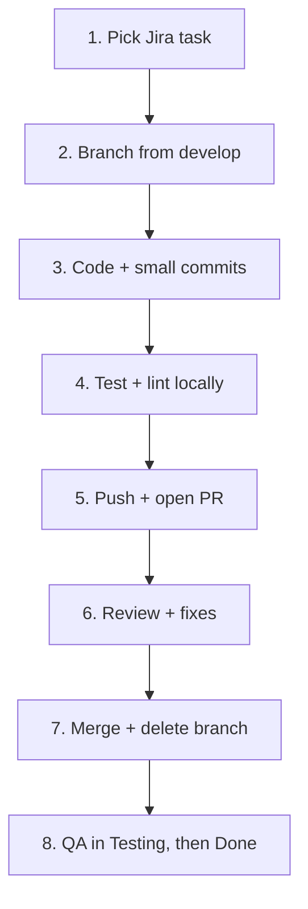

# Contributing to LawAid

Welcome to the **SysVision** team repository for LawAid, a verified lawyer consultation and case management platform for Bangladesh (CSE 3422 Software Engineering, UIU).

This guide covers **how we work together**. It follows `PROJECT_GUIDELINES.md` (Git §6, Jira §5, Testing §11, Academic integrity §15).

> **Replace `LAW` in examples with our real Jira project key.**

---

## 1. Quick links

| Topic | Document |
|---|---|
| Project overview, scope, stack | [`README.md`](README.md) |
| Branch names, commits, merging | [`docs/BRANCHING_STRATEGY.md`](docs/BRANCHING_STRATEGY.md) |
| PR and review rules | [`docs/PR_REVIEW_RULES.md`](docs/PR_REVIEW_RULES.md) |
| Backend setup | [`backend/README.md`](backend/README.md) |
| Frontend setup | [`frontend/README.md`](frontend/README.md) |
| AI service (stretch) | [`ai-service/README.md`](ai-service/README.md) |

---

## 2. Team agreements

- Every member has **clear responsibilities** but must understand the **whole system**
- Everyone commits **from their own GitHub account**
- Jira is updated **as work happens**, not before a presentation
- Ask for help early; blockers go on the Jira task and in the team chat
- Be respectful in reviews and discussions

---

## 3. One-time setup

### 3.1 Tools

| Tool | Recommended version | Needed for |
|---|---|---|
| Git | latest | everything |
| Node.js | 20 LTS | backend, frontend |
| npm | bundled with Node | backend, frontend |
| PostgreSQL | 15+ (local, or Neon / Supabase) | backend |
| Python | 3.11+ | ai-service only (optional) |
| VS Code (or similar) | latest | editor |

### 3.2 Clone and configure Git

```bash
git clone https://github.com/splashahnaf445/LawAid.git
cd LawAid
git config user.name  "Your Real Name"
git config user.email "the-email-used-on-your-github-account"
git checkout develop
```

> Use the **same email as your GitHub account** so your commits count as yours.

### 3.3 Environment files

```bash
cp backend/.env.example      backend/.env
cp frontend/.env.example     frontend/.env.local
cp ai-service/.env.example   ai-service/.env     # only if working on ai-service
```
- Fill in your own values. **Never commit** `.env` or `.env.local`
- Ask the team lead for shared sandbox credentials privately (not in chat history or code)
- If you add a new variable, add it to the matching `.env.example` in the same PR

### 3.4 Run each part

See [`backend/README.md`](backend/README.md) and [`frontend/README.md`](frontend/README.md).

---

## 4. Workflow in 8 steps



1. **Pick a task** from *To Do* in Jira. Assign it to yourself and move to **In Progress**
2. **Branch** from `develop`: `feature/LAW-12-short-description`
3. **Code** in small steps; commit often with the convention below
4. **Test and lint** before pushing
5. **Push** and open a **PR into `develop`** with the template
6. **Respond to review** comments
7. **Merge** after approval, delete the branch
8. **QA** verifies; task goes to **Testing**, then **Done**

Full details: [`docs/BRANCHING_STRATEGY.md`](docs/BRANCHING_STRATEGY.md).

---

## 5. Jira workflow (Kanban board)

| Column | Meaning | Who moves it |
|---|---|---|
| **Backlog** | Idea or future story, not yet prioritised | Team lead |
| **To Do** | Ready to start, has description + acceptance criteria | Team lead |
| **In Progress** | You are actively working; branch exists | Assignee |
| **In Review** | PR is open | Assignee |
| **Testing** | Merged to `develop`; QA verifying | Assignee / QA |
| **Done** | Verified and complete | QA / team lead |

A good Jira task has:
- [ ] Clear title and description
- [ ] **Acceptance criteria**
- [ ] One assignee, a priority and a reasonable deadline
- [ ] Linked epic (for example *Authentication*, *Booking*, *Case Management*)
- [ ] Blockers and dependencies recorded
- [ ] Bugs logged as **Bug** issues with steps to reproduce

---

## 6. Commit messages

```
<type>(<scope>): <summary> [LAW-12]
```
Examples:
- `feat(auth): add JWT login endpoint [LAW-12]`
- `fix(bookings): prevent double-booking [LAW-41]`
- `docs(readme): add setup steps [LAW-3]`

Types and scopes are listed in [`docs/BRANCHING_STRATEGY.md`](docs/BRANCHING_STRATEGY.md#5-commit-message-convention).

---

## 7. Code standards

| Area | Rule |
|---|---|
| Language | TypeScript in `backend/` and `frontend/` (no `any` unless justified) |
| Formatting | **Prettier** (auto-format on save) |
| Linting | **ESLint**, zero errors before PR |
| Naming | `camelCase` variables/functions, `PascalCase` components/classes, `kebab-case` file names, `UPPER_SNAKE_CASE` constants |
| Backend structure | One folder per module: auth, users, lawyers, bookings, chat, cases, payments, notifications, reviews, reports, admin |
| Database access | **Prisma only**. No raw string-built SQL |
| Validation | Validate all input on the **server** (for example with Zod) |
| Errors | Return consistent JSON errors with correct HTTP status codes |
| Comments | Explain **why**, not what. Remove dead code |
| Python (ai-service) | PEP 8, type hints, `ruff` formatting |

---

## 8. Testing expectations

- **Unit tests** (Jest) for business logic: booking rules, payment state, role checks
- **API tests** (Jest + Supertest) for endpoints, including **negative** cases
- **End-to-end tests** (Playwright) for key flows, owned by QA
- **Manual API checks** with Postman collections stored in `docs/`
- Target **60%+ coverage** for core business logic (NFR-15)
- Maintain the **test-case document** (test ID, scenario, input, expected, actual, status), required by `PROJECT_GUIDELINES.md` §11
- Log known defects in Jira

Before every PR:
```bash
npm run lint
npm run test
npm run build
```
(run inside `backend/` and/or `frontend/`, depending on what you changed)

---

## 9. Security checklist for contributors

- ❌ Never commit `.env`, API keys, passwords, tokens, database dumps with real data
- ❌ Never use real NID numbers, certificates, or real case documents as test data. Use **fake seed data**
- ✅ Hash passwords with **bcrypt**
- ✅ Check **role and ownership** on every route
- ✅ Serve private files only through **short-lived signed links**
- ✅ Keep payments in **sandbox mode**
- If you accidentally commit a secret: **tell the team lead immediately**, rotate the secret, then clean the history. Deleting the file in a later commit is **not** enough

---

## 10. Database changes

- Edit `backend/prisma/schema.prisma`, then create a migration:
  ```bash
  npx prisma migrate dev --name add_hearing_table
  ```
- Commit the migration folder together with the schema change
- **Never edit** a migration that is already on `develop`; add a new one
- Keep the schema normalised to **3NF** and be ready to explain the choice (`PROJECT_GUIDELINES.md` §8.3)
- Update seed data and the ER diagram in `docs/` if tables change

---

## 11. Documentation duties

Update docs **in the same PR** as the code when you change:
- Setup steps or environment variables
- API endpoints (API docs)
- Database schema (ERD + normalisation notes)
- Behaviour that appears in the user manual

Docs must match the real implementation (`PROJECT_GUIDELINES.md` §12).

---

## 12. Academic integrity

From `PROJECT_GUIDELINES.md` §15:
- Submit **original work** and credit libraries, tutorials and AI tools used
- **Do not fabricate** Jira activity, commits, test results or progress
- Do not make commits only for evaluation; **contribute steadily**
- Do not submit another member's work as your own
- Every member must be able to **explain the code attributed to them**
- Protect personal and sensitive data

---

## 13. Definition of Done

A task is **Done** only when:
- [ ] Acceptance criteria are met
- [ ] Code reviewed and merged into `develop`
- [ ] Tests written and passing
- [ ] Lint and build pass
- [ ] Docs updated (if needed)
- [ ] QA verified on `develop`
- [ ] Jira task moved to **Done**

---

## 14. Getting help

- **Blocked?** Add a comment on the Jira task and tell the team lead
- **Unsure about a design choice?** Open a draft PR or a Jira comment early
- **Stuck on Git?** Do not force-push to fix it. Ask first
