<div align="center">

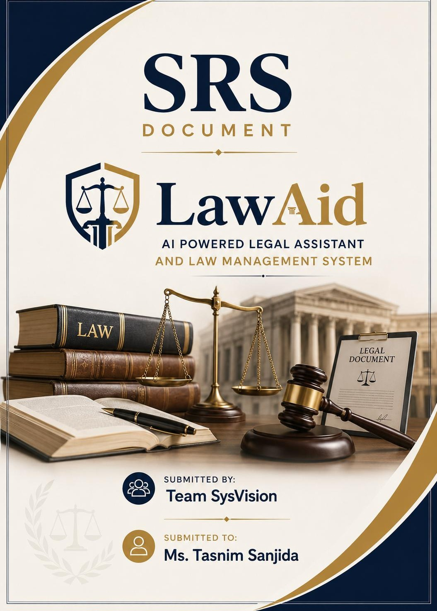

# ⚖️ LawAid

### AI-Powered Legal Assistant & Law Management System for Bangladesh

*Verified lawyers · AI matching · Case management · Escrow payments · Free bilingual legal assistant*


**[📄 Read the full SRS (PDF)](docs/LawAid_SRS_SysVision.pdf)** · **[🎨 UI/UX prototype](docs/03-system-design/ui-ux-prototype)** · **[📐 UML diagrams](docs/03-system-design/uml-diagrams)** · **[📊 Survey results](docs/02-requirement-analysis/survey.md)**

</div>

---

## 📌 Overview

Legal help in Bangladesh still depends on word-of-mouth referrals and physical chamber visits, concentrated in major cities. Existing platforms each solve one slice: a lawyer directory, *or* a chatbot, *or* case tools.

**LawAid combines all three in one platform:**

| For | What LawAid provides |
|---|---|
| 🧑‍💼 **Clients** | AI-matched, verified lawyers; booking by video, audio, chat or in-person; escrow payments with QR-verified receipts; 24/7 SOS lawyer finder |
| ⚖️ **Lawyers** | Practice-management dashboard: availability, appointments, cases, hearings, documents, payments |
| 🌐 **General public** | Free bilingual (Bangla + English) AI assistant explaining basic laws, rights and consequences |
| 🛡️ **Admins** | NID and Bar Council credential verification, moderation, confidential misconduct reports |

> **Project status:** this repository documents the **Planning → Requirement Analysis → System Design** phases of the SDLC, completed as a team project for the *System Analysis and Design* course at United International University. Implementation is the next phase.

---

## 🎨 UI/UX Prototype

High-fidelity design in Figma, covering Client, Lawyer and Admin roles on web and mobile. Full gallery and design system: [`ui-ux-prototype/`](docs/03-system-design/ui-ux-prototype).

### Web

| Landing page | Role access | Admin dashboard |
|:---:|:---:|:---:|
| 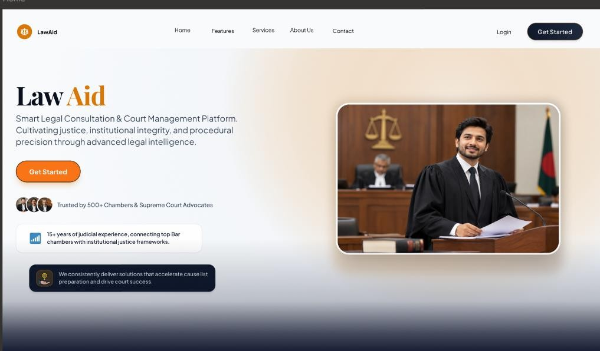 | 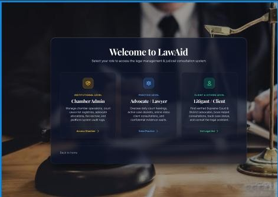 | 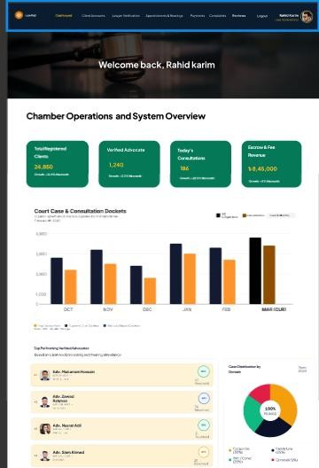 |
| **AI assistant (bilingual)** | **Lawyer dashboard** | **Lawyer cases** |
| 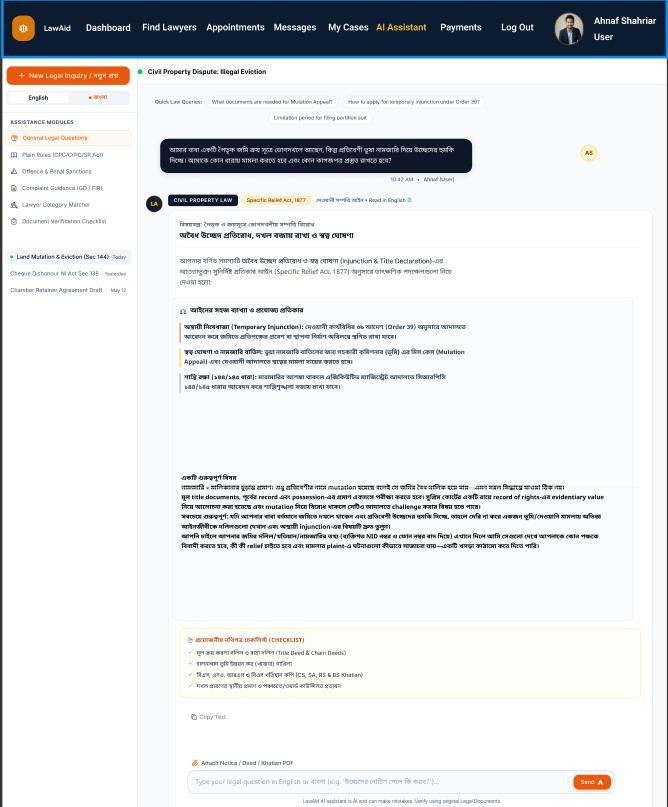 | 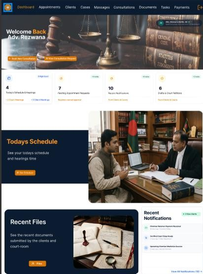 | 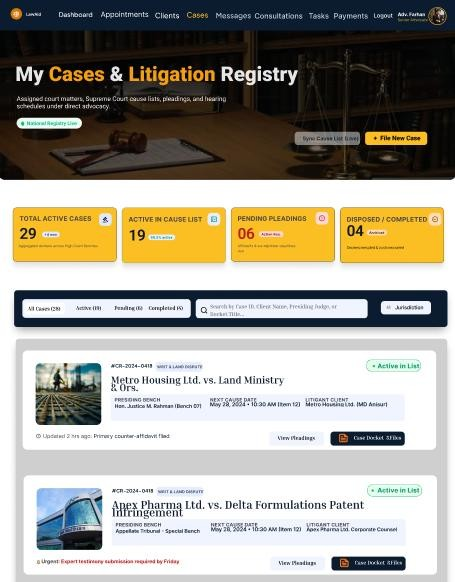 |

### Mobile

| Home | Login | Admin control | Client dashboard | Consultations | Video call | Messages |
|:---:|:---:|:---:|:---:|:---:|:---:|:---:|
| 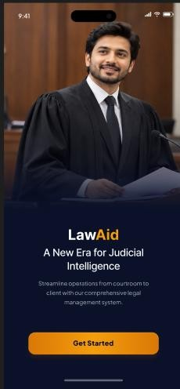 | 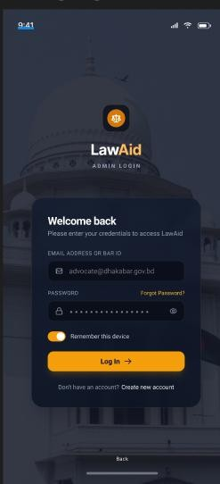 | 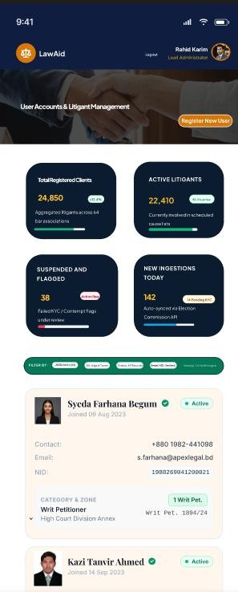 | 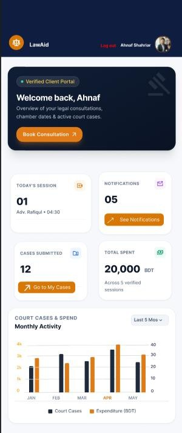 | 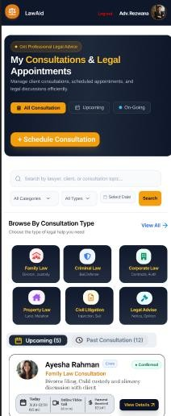 |  | 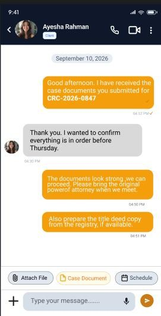 |

---

## ✨ Core Features

| Module | Highlights | Requirements |
|---|---|---|
| **Registration & verification** | Separate client/lawyer flows · NID + Bar Council upload · verification badge · JWT auth | FR-1 to FR-5 |
| **Search & AI matching** | Filter by specialization, location, rating, fee · AI recommendations from the client's legal issue | FR-6 to FR-9 |
| **Booking & consultation** | Free/paid slots · video, audio, chat, in-person · in-app calling · reminders · 24/7 SOS | FR-10 to FR-16 |
| **Case management** | Case dashboard · hearing dates · document storage · status updates | FR-17 to FR-20 |
| **Payments** | SSLCommerz, bKash, Nagad · escrow · QR-verified receipts · disputes | FR-21 to FR-25 |
| **Bilingual AI assistant** | Free public chatbot · Bangla + English · general legal information only, with a prompt to book a lawyer | FR-26 to FR-29 |
| **Ratings & trust** | Ratings and reviews · confidential misconduct reports (admin-only) | FR-30 to FR-33 |
| **Security & notifications** | RBAC · end-to-end encryption · push/SMS alerts · audit log | FR-34 to FR-37 |
| **Administration** | Verification queue · suspend/remove accounts · review reports | FR-38 to FR-40 |

All 40 functional and 22 non-functional requirements: [`02-requirement-analysis`](docs/02-requirement-analysis).

---

## 🔬 Validated, Not Assumed

- **Survey:** 23 questions, up to 59 responses from clients and lawyers
- **86.4%** found AI-based lawyer matching useful · **89.8%** wanted the SOS emergency lawyer finder
- **49.2%** raised privacy concerns and **42.4%** payment concerns, which led to verification, escrow and encryption
- **Benchmark:** 12 features across 5 platforms (UkilBD, FindMyAdvocate, PathLegal, LawRato, DoNotPay) found **no competitor** combining verified consultation, case management and public legal literacy

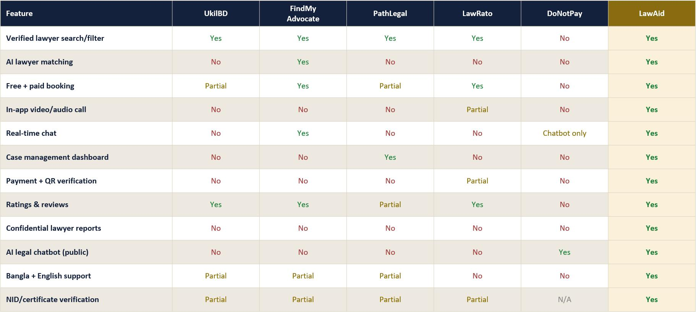

---

## 🏗️ Architecture

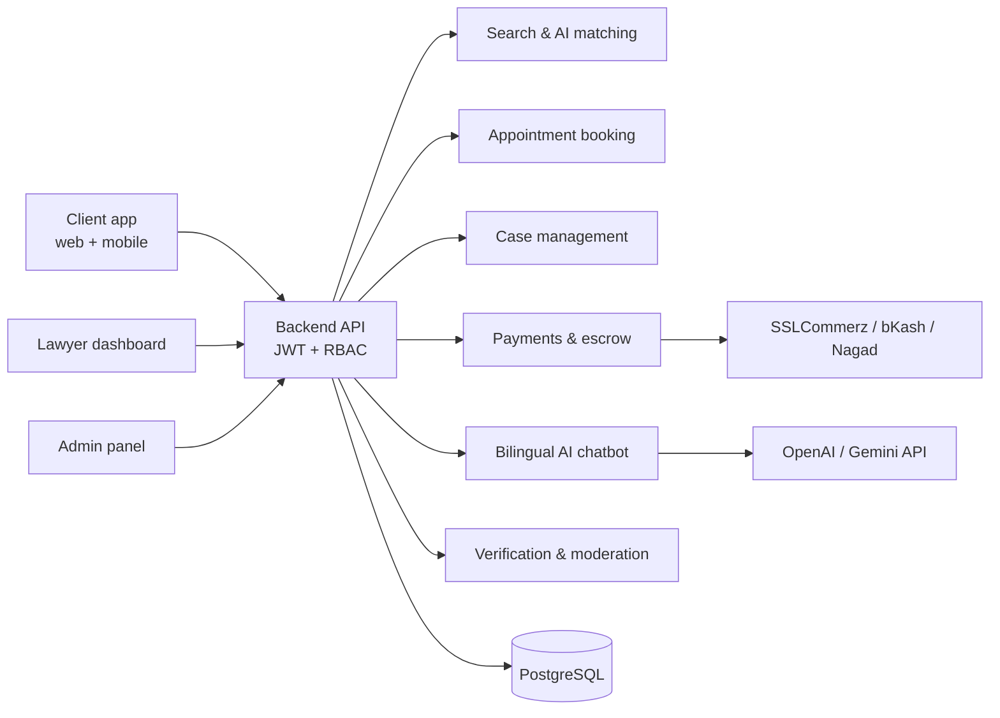

Full UML set (use case, activity, DFD, class, sequence, state, CRC): [`uml-diagrams/`](docs/03-system-design/uml-diagrams)

| Use case diagram | Class diagram |
|:---:|:---:|
| 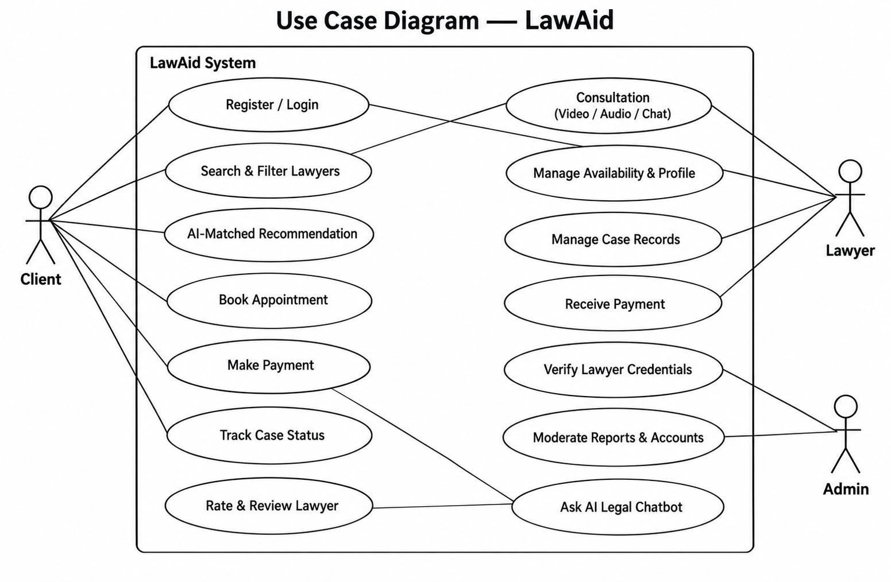 | 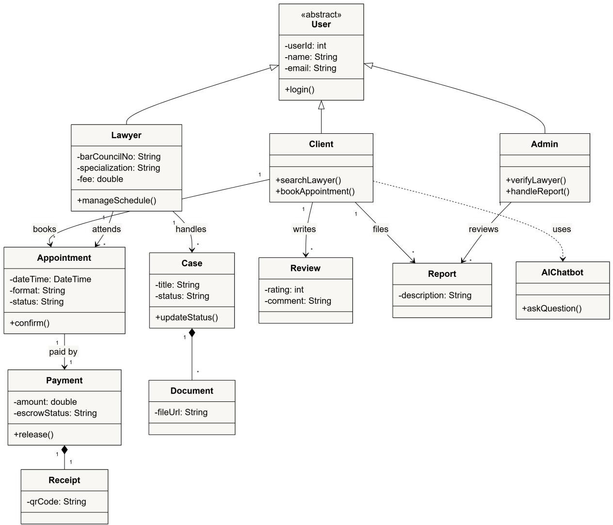 |

---

## 🔄 SDLC Progress (Agile)

| # | Phase | Status | Folder |
|---|---|:---:|---|
| 1 | Planning | ✅ | [`docs/01-planning`](docs/01-planning) |
| 2 | Requirement analysis | ✅ | [`docs/02-requirement-analysis`](docs/02-requirement-analysis) |
| 3 | System design (UML + UI/UX) | ✅ | [`docs/03-system-design`](docs/03-system-design) |
| 4 | Implementation | 🔜 | planned |
| 5 | Testing | 🔜 | planned |
| 6 | Deployment & maintenance | 🔜 | planned |

## 🧰 Planned Tech Stack


AI via OpenAI / Gemini API · Cloudinary for media · Google Maps API · payments via SSLCommerz, bKash, Nagad.

---

## 📁 Repository Structure

```text
LawAid/
├── README.md
├── LICENSE
├── assets/                          # cover image
└── docs/
    ├── LawAid_SRS_SysVision.pdf     # complete SRS (PDF)
    ├── LawAid_SRS_SysVision.docx    # editable source
    ├── 01-planning/                 # problem, goals, Agile SDLC, feasibility, SWOT
    ├── 02-requirement-analysis/     # survey, benchmark, gap analysis, FR, NFR
    ├── 03-system-design/
    │   ├── uml-diagrams/            # use case, activity, DFD, class, sequence, state, CRC
    │   ├── use-case-descriptions.md
    │   └── ui-ux-prototype/         # web + mobile screens, design system
    └── future-work-and-references.md
```

## 🚀 Future Work

RAG-grounded AI assistant that cites exact Acts and sections · e-Judiciary integration · free legal-aid referral · voice and low-bandwidth access · legal document automation · online mediation · fairer lawyer matching · data-protection compliance review · pilot deployment. Details in [`future-work-and-references.md`](docs/future-work-and-references.md).

## 👥 Team SysVision

| Member |
|---|
| Rahid Karim |
| [Ahnaf Shahriar](https://github.com/splashahnaf445) |
| Sk. Istiaq Arefin |
| Nafseen Hossain |
| Sumaiya Akther |
| Rifa Sanjida |
| Shafiul Alam |

**Course:** System Analysis and Design (SAD), United International University · **Instructor:** Ms. Tasnim Sanjida

## 📄 License

[MIT](LICENSE) © Team SysVision

> ⚠️ LawAid's AI assistant is designed to provide **general legal information only**, not legal advice. Case-specific matters should go to a verified lawyer.
