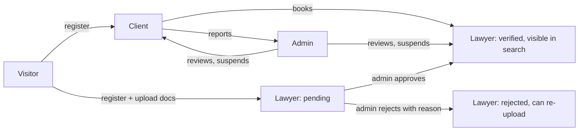
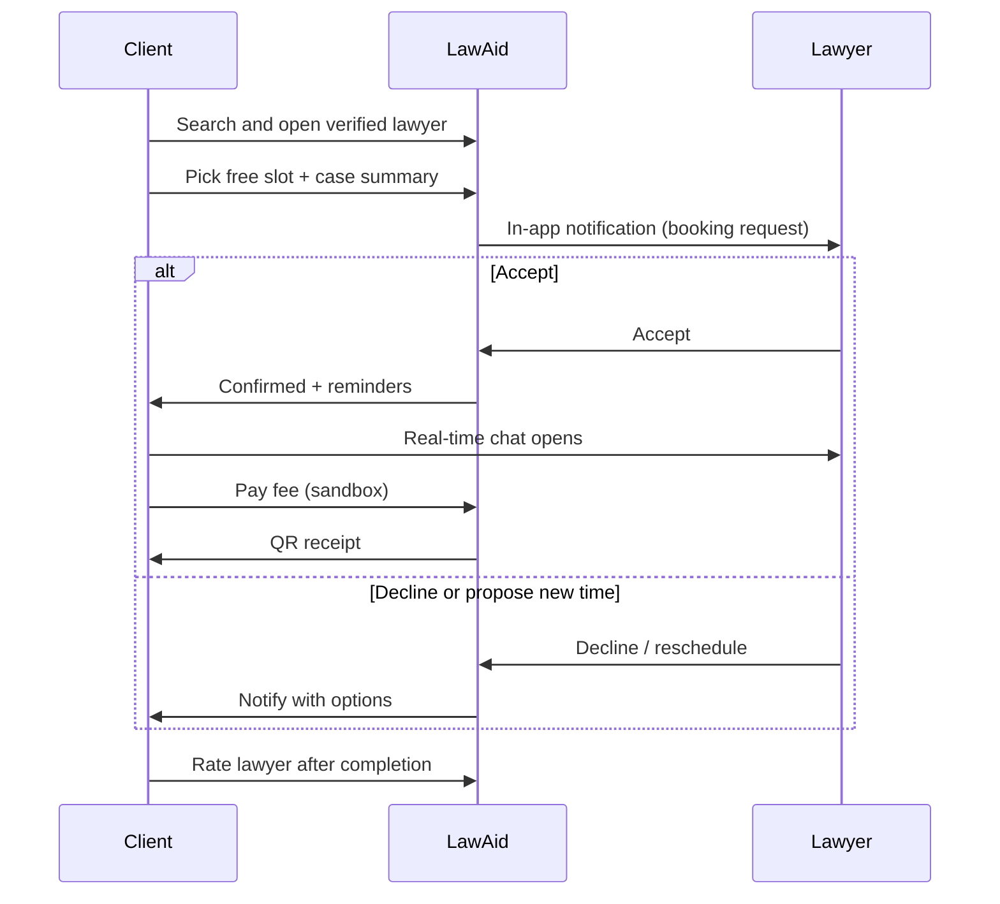
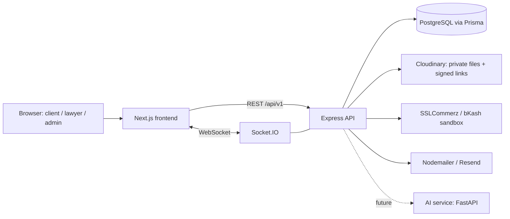
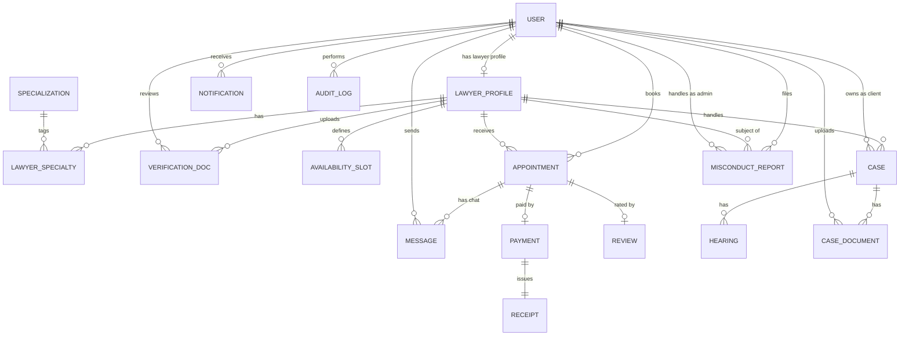
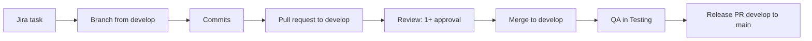

# ⚖️ LawAid

**A Verified Lawyer Consultation and Case Management Platform for Bangladesh**

> CSE 3422 Software Engineering · Section D · United International University (UIU)
> Team **SysVision** · Instructor: Saifullah Mahbub

LawAid is a web platform where clients find and book **Bar Council–verified lawyers**, consult them online, and track their cases and payments, while lawyers manage appointments, hearings and case files in one place.

---

## 📑 Table of contents

1. [Project status](#1-project-status)
2. [Problem and background](#2-problem-and-background)
3. [Objectives](#3-objectives)
4. [Scope](#4-scope)
5. [Users and roles](#5-users-and-roles)
6. [Functional requirements](#6-functional-requirements-34)
7. [Non-functional requirements](#7-non-functional-requirements-17)
8. [System architecture](#8-system-architecture)
9. [Technology stack](#9-technology-stack)
10. [Database design](#10-database-design)
11. [Repository structure](#11-repository-structure)
12. [Getting started](#12-getting-started)
13. [Environment variables](#13-environment-variables)
14. [Development workflow](#14-development-workflow)
15. [Project management (Jira)](#15-project-management-jira)
16. [Testing and QA](#16-testing-and-quality-assurance)
17. [Timeline and mandatory progress updates](#17-timeline-and-mandatory-progress-updates)
18. [Course requirements checklist](#18-course-requirements-checklist)
19. [Final submission checklist](#19-final-submission-checklist)
20. [Team](#20-team)
21. [Limitations and future work](#21-limitations-and-future-work)
22. [Security and privacy rules](#22-security-and-privacy-rules)
23. [Documentation index](#23-documentation-index)
24. [Academic integrity and references](#24-academic-integrity-and-references)

---

## 1. Project status

| Item | Status |
|---|---|
| Phase | Repository setup (first Jira task), moving into design and Sprint 1 |
| Backend | 🚧 Folder and docs ready, app not yet scaffolded |
| Frontend | 🚧 Folder and docs ready, app not yet scaffolded |
| AI service | 🟡 Placeholder only (future work, see [§4](#4-scope)) |
| Scope baseline | **Project Proposal** (CSE 3422). If instructor feedback changes the scope, this README is updated |

> The earlier SAD-phase SRS describes a **larger vision** (AI chatbot, video/audio calls, SOS finder, escrow payments, native apps). For this semester those items are **future work**. This README follows the narrower, achievable Proposal scope.

---

## 2. Problem and background

### The situation in Bangladesh
- People usually find lawyers through relatives, neighbours or chamber visits
- No easy way to check a lawyer's **Bar Council enrolment**, fees or track record
- Legal services are concentrated in **Dhaka and district towns**; rural users spend time and money just to reach a lawyer
- Lawyers keep appointments, hearing dates and files in **paper diaries**, causing missed hearings, clashes and lost documents
- Existing platforms cover only parts of the problem (directory, or booking, or a basic case tool)

### Problem statement
> People in Bangladesh cannot easily find, verify, book and work with a lawyer online, and lawyers lack a simple digital tool to manage their practice.

### Pain points we solve

| Problem | How LawAid solves it |
|---|---|
| No verification | Only lawyers approved by an admin after NID and Bar Council checks appear, with a **Verified** badge |
| Unclear fees | Every profile shows the consultation fee; clients filter and sort by fee |
| Manual booking by phone | Clients pick an open slot online; lawyers confirm in one click; both get reminders |
| Paper case records | Cases, hearings and documents are online and visible to the client |
| No accountability | Ratings after each consultation and **confidential misconduct reports** to admins |
| Untracked cash payments | Each payment produces a receipt with a **QR code** anyone can verify |

### Evidence from the earlier SAD work
- Requirements survey with up to **59 responses** and a benchmark of 5 platforms across 12 features

| Survey finding | Share |
|---|---|
| Would value a 24/7 emergency lawyer finder | 89.8% |
| Find AI-based lawyer matching useful (future work) | 86.4% |
| Prefer an online session under 1,000 BDT | 78% |
| Worried about privacy | 49.2% |

### Existing platforms (benchmark)

| Platform | Covers | Lacks |
|---|---|---|
| UkilBD | Directory and advice | Booking, chat, case management |
| FindMyAdvocate | Matching and booking | Case management, verified payments |
| PathLegal | Directory and case tool | In-app consultation, payment receipts |
| LawRato (India) | Large marketplace | Not for Bangladesh, no case management |
| DoNotPay (USA) | Consumer legal chatbot | No lawyer network, not for Bangladesh |

---

## 3. Objectives

By the end of the semester, LawAid will:

1. Let clients and lawyers **register and log in securely**, with role-based access for client, lawyer and admin
2. **Verify every lawyer's NID and Bar Council certificate** through admin review before the lawyer appears in search
3. Let clients **search and filter** verified lawyers by specialization, district, court, fee and rating
4. Let clients **book a consultation slot** that the lawyer can accept, reschedule or decline
5. Provide **real-time text chat** between client and lawyer for each booked consultation
6. Give lawyers a **case dashboard** for cases, hearing dates, status and documents, visible to the related client
7. Process fees through a **sandbox payment gateway** and issue **QR-verifiable receipts**
8. Send **in-app and email reminders** for appointments and hearings
9. Let clients **rate lawyers** and submit **confidential misconduct reports** only admins can see
10. Give admins tools to **approve or reject lawyers, review reports and suspend accounts**

---

## 4. Scope

### ✅ Included

- Registration, login, password recovery, role-based access control
- Lawyer verification workflow with document upload and admin approval queue
- Lawyer search, filtering, sorting, public profiles
- Appointment booking with time slots (online chat or in-person)
- Real-time client–lawyer text chat
- Case management: cases, hearings, status, documents
- Payments in gateway **sandbox mode** with QR-verifiable receipts and history
- In-app and email notifications and reminders
- Ratings, reviews and confidential misconduct reports
- Admin panel: verification, moderation, account control
- **Bangla and English** interface

### ❌ Excluded (this semester)

- AI legal chatbot and AI lawyer recommendation (**future work**)
- Live video and audio calling inside the platform
- Native Android and iOS apps (web app is mobile-responsive instead)
- Real-money payments, escrow and transaction disputes
- SMS and push notifications
- 24/7 emergency (SOS) lawyer finder
- Integration with court systems or government databases
- Automatic verification of NID or Bar Council records (verification is **manual by admins**)

---

## 5. Users and roles

| Role | What they can do |
|---|---|
| **Visitor** (not logged in) | Browse the landing page and public list of verified lawyers |
| **Client** | Register, search and view verified lawyers, book consultations, chat, pay, track case status, download receipts, rate and report lawyers |
| **Lawyer** | Register, upload NID and Bar Council certificate, manage profile, fees and availability, accept or decline bookings, chat, manage cases, hearings and documents |
| **Administrator** | Approve or reject lawyer verification, review confidential reports, suspend or remove accounts, view platform activity |



---

## 6. Functional requirements (34)

Priority: **M** = must have for the final demo, **S** = should have if time allows.

| Module | ID | Requirement | Pri |
|---|---|---|---|
| Authentication | FR-1 | Register as Client or Lawyer through separate sign-up forms | M |
| | FR-2 | Log in with email and password; JWT sessions with expiry | M |
| | FR-3 | Reset forgotten password through an emailed link | M |
| | FR-4 | Restrict every page and API route by role | M |
| Profiles | FR-5 | View and update own profile; change password | M |
| Lawyer verification | FR-6 | Lawyers upload NID and Bar Council certificate at sign-up | M |
| | FR-7 | Admins see a pending queue and approve or reject with a reason | M |
| | FR-8 | Only approved lawyers appear in search and show a "Verified" badge | M |
| Lawyer profile | FR-9 | Set specialization, court, district, experience, fee, weekly availability | M |
| Search | FR-10 | Search by name; filter by specialization, district, court, fee range, rating | M |
| | FR-11 | Sort by rating, fee or experience, with pagination | M |
| | FR-12 | Public profile with details, fee, availability, reviews | M |
| Booking | FR-13 | Choose a free slot and book online or in-person with a short case summary | M |
| | FR-14 | Lawyers accept, decline or propose a new time | M |
| | FR-15 | Clients and lawyers cancel before start time | M |
| | FR-16 | Upcoming and past appointments in list and calendar view | M |
| Consultation | FR-17 | Confirmed booking opens real-time text chat | M |
| | FR-18 | Share files (PDF, image) in chat | S |
| Case management | FR-19 | Lawyers create a case linked to a client (title, number, court, type) | M |
| | FR-20 | Add hearing dates; update status (open, in progress, closed) | M |
| | FR-21 | Lawyers and clients upload, view and download case documents | M |
| | FR-22 | Clients view status, hearings and documents of their own cases | M |
| Payments | FR-23 | Pay consultation fee via SSLCommerz or bKash **sandbox** | S |
| | FR-24 | Digital receipt with QR code linking to a verification page | S |
| | FR-25 | Payment history and receipt download as PDF | S |
| Notifications | FR-26 | In-app notifications for booking, case and payment events | M |
| | FR-27 | Email reminders before appointments and hearings | S |
| Reviews | FR-28 | Rate (1–5) and review after a completed consultation | M |
| | FR-29 | Profiles show average rating and review count | M |
| Reports | FR-30 | Clients submit confidential misconduct reports visible only to admins | M |
| Administration | FR-31 | Admins review reports and record action and resolution note | M |
| | FR-32 | Admins suspend, reactivate or remove accounts | M |
| | FR-33 | Dashboard of user, lawyer, booking and report counts | S |
| | FR-34 | Log critical actions (logins, approvals, bookings, payments, uploads) for audit | M |

**Totals:** 28 must-have · 6 should-have.

### Core booking flow



---

## 7. Non-functional requirements (17)

| ID | Quality | Requirement | How we check it |
|---|---|---|---|
| NFR-1 | Security | Passwords stored as **bcrypt** hashes; no plain text anywhere | DB inspection, code review |
| NFR-2 | Security | HTTPS everywhere; JWT access tokens expire within **1 hour** | Deployment config, token test |
| NFR-3 | Security | NID, certificates and case documents are private; served only through **signed links expiring within 15 minutes** | Open expired link; access as another user |
| NFR-4 | Security | Every API route checks role; users cannot read others' cases, chats or payments | Automated access-control tests |
| NFR-5 | Security | Server-side validation against SQL injection and XSS | Validation tests, ORM-only queries |
| NFR-6 | Privacy | Confidential reports and verification documents visible only to admins | Role tests |
| NFR-7 | Performance | Search and profile pages load in **under 3 seconds** with 1,000 lawyer records | Load test with seeded data |
| NFR-8 | Performance | Chat messages delivered in **under 1 second** on a normal connection | Manual timing in two browsers |
| NFR-9 | Usability | Every screen works from **360 px** up | Responsive check on 3 sizes |
| NFR-10 | Usability | Search to booking request in **5 steps or fewer** | Walkthrough with 5 users |
| NFR-11 | Usability | **Bangla and English**, switchable on every page | UI review |
| NFR-12 | Reliability | Payment never recorded without a matching booking; booking never marked paid without successful payment | DB transactions and payment tests |
| NFR-13 | Reliability | Daily database backup that can be restored | Restore test before final demo |
| NFR-14 | Maintainability | Backend split into modules (auth, lawyers, bookings, cases, payments, admin) with consistent style | ESLint, Prettier, PR review |
| NFR-15 | Maintainability | Core business logic has **60%+ unit-test coverage** | Jest coverage report |
| NFR-16 | Scalability | API is **stateless** so more instances can run behind a load balancer | Architecture review |
| NFR-17 | Data integrity | Foreign keys, unique constraints, schema normalised to **3NF** | Schema review |

---

## 8. System architecture



Key decisions:
- **One language (TypeScript)** across frontend and backend so all five members can work anywhere in the codebase
- **Stateless API** with JWT so it can scale behind a load balancer
- **Modular backend**: auth, users, lawyers, bookings, chat, cases, payments, notifications, reviews, reports, admin
- **Private files** (NID, certificates, case documents) only via short-lived signed links
- **Payments** only in sandbox mode, wrapped in database transactions
- **AI service is optional** and isolated, so the core app never depends on it

---

## 9. Technology stack

| Layer | Technology | Why |
|---|---|---|
| Frontend | **Next.js (React)**, TypeScript, Tailwind CSS | Responsive pages from one codebase; matches the Figma design |
| Backend | **Node.js, Express.js**, TypeScript | REST API with a large ecosystem the team knows |
| Real-time | **Socket.IO** | Two-way chat and live notifications |
| Database | **PostgreSQL** with **Prisma ORM** | Foreign keys, transactions, migrations |
| File storage | **Cloudinary** (private assets) | Signed, expiring links for sensitive documents |
| Auth | **JWT**, **bcrypt** | Stateless sessions, secure hashing |
| Payments | **SSLCommerz** and **bKash** sandbox APIs | Local gateways, no real money |
| Email | **Nodemailer** (Gmail SMTP) or **Resend** | Password reset and reminders |
| Version control | **Git + GitHub** (feature branches, PRs) | Review before every merge |
| Project management | **Jira** (Kanban board) | Backlog and progress tracking |
| Design | **Figma** | Reuses the existing LawAid prototype |
| Testing | **Jest**, **Supertest**, **Postman**, **Playwright** | Unit, API, manual API, end-to-end |
| Deployment | **Vercel** (frontend), **Render** (backend), **Neon or Supabase** (PostgreSQL) | Free tiers for a student project |
| AI (future) | Python, FastAPI | Isolated optional service |

**Framework justification (course §7):** Next.js and Express.js are used for real application functionality: routing, server logic, authentication, validation and real-time messaging. No part of the project is plain HTML/CSS/JS only.

---

## 10. Database design

PostgreSQL with Prisma. **17 entities**, refined to **Third Normal Form (3NF)**.

### Entities

| Entity | Purpose | Key relations |
|---|---|---|
| `User` | Everyone: client, lawyer, admin | Hub of the schema |
| `Lawyer_Profile` | Lawyer-only attributes | 1:0..1 with User |
| `Specialization` | Family, Land, Criminal, Corporate... | M:N with Lawyer_Profile |
| `Lawyer_Specialty` | Junction table | Lawyer_Profile ↔ Specialization |
| `Verification_Doc` | NID and Bar certificate uploads | N:1 Lawyer_Profile, reviewed by User |
| `Availability_Slot` | Weekly lawyer availability | N:1 Lawyer_Profile |
| `Appointment` | A booking | Client (User) and Lawyer_Profile |
| `Message` | Chat messages | N:1 Appointment, sender User |
| `Payment` | Fee payment | 1:0..1 with Appointment |
| `Receipt` | QR-verifiable receipt | 1:1 with Payment |
| `Review` | Rating and comment | 1:0..1 with Appointment |
| `Case` | Legal case | Lawyer_Profile and client User |
| `Hearing` | Hearing dates | N:1 Case |
| `Case_Document` | Case files | N:1 Case, uploaded by User |
| `Misconduct_Report` | Confidential report | Reporter User, Lawyer_Profile, handled by admin User |
| `Notification` | In-app notifications | N:1 User |
| `Audit_Log` | Critical action log | N:1 User |

### ER diagram (preliminary)



### Normalisation notes (be ready to explain these)

| Normal form | Decision in our schema |
|---|---|
| **1NF** | Specializations moved to their own table plus junction table, so no repeating groups in one column |
| **2NF** | Junction table `Lawyer_Specialty` has a composite key and no extra attributes depending on only part of it |
| **3NF** | `Review` links only to `Appointment`; client and lawyer are found through it, so storing them again would be a transitive dependency |
| Design choice | Lawyer-only attributes live in `Lawyer_Profile`, so client rows have no empty lawyer columns |

### Database deliverables (course §8)
- [ ] ER diagram (final)
- [ ] Relational schema with data types, PK, FK, unique constraints
- [ ] Normalisation explanation up to 3NF
- [ ] Prisma schema and **migration files**
- [ ] Meaningful **seed data** (fake only)
- [ ] Example queries: joins, filtering, aggregation (for example average rating, counts for admin dashboard)
- [ ] Indexes where justified (for example lawyer search filters)
- [ ] Exported database or reliable setup procedure

---

## 11. Repository structure

```
LawAid/
├── .github/
│   └── pull_request_template.md   # PR checklist
├── backend/                       # Node.js + Express + Prisma API
│   ├── README.md
│   └── .env.example
├── frontend/                      # Next.js web app
│   ├── README.md
│   └── .env.example
├── ai-service/                    # Optional FastAPI service (future work)
│   ├── README.md
│   └── .env.example
├── docs/
│   ├── BRANCHING_STRATEGY.md
│   └── PR_REVIEW_RULES.md
├── CONTRIBUTING.md
├── README.md                      # you are here
└── .gitignore
```

Folders added later in `docs/` (planned): `srs/`, `design/` (architecture, ERD, schema, normalisation), `api/`, `testing/` (test-case document, reports), `report/`, `presentation/`.

---

## 12. Getting started

> Backend and frontend apps are scaffolded in Sprint 1. Until then, use this section to prepare your machine.

### Prerequisites

| Tool | Version |
|---|---|
| Git | latest |
| Node.js | 20 LTS |
| PostgreSQL | 15+ (local, or Neon / Supabase) |
| Python | 3.11+ (only for `ai-service`) |

### Clone

```bash
git clone https://github.com/splashahnaf445/LawAid.git
cd LawAid
git checkout develop
```

### Configure

```bash
cp backend/.env.example     backend/.env
cp frontend/.env.example    frontend/.env.local
```

### Run (after Sprint 1 scaffolding)

```bash
# Terminal 1: backend
cd backend
npm install
npx prisma migrate dev
npm run seed
npm run dev            # http://localhost:4000

# Terminal 2: frontend
cd frontend
npm install
npm run dev            # http://localhost:3000
```

Detailed instructions: [`backend/README.md`](backend/README.md), [`frontend/README.md`](frontend/README.md), [`ai-service/README.md`](ai-service/README.md).

---

## 13. Environment variables

| Where | File | Main variables |
|---|---|---|
| Backend | `backend/.env` | `DATABASE_URL`, `JWT_ACCESS_SECRET`, `CLOUDINARY_*`, `SSLCOMMERZ_*`, `BKASH_*`, `SMTP_*` or `RESEND_API_KEY` |
| Frontend | `frontend/.env.local` | `NEXT_PUBLIC_API_URL`, `NEXT_PUBLIC_SOCKET_URL` |
| AI service | `ai-service/.env` | `AI_SERVICE_API_KEY`, `LLM_*` |

⚠️ **Never commit** `.env` files, API keys, passwords or production credentials (course §6.1). Only `.env.example` files with placeholders are tracked. Share sandbox credentials privately with the team lead.

---

## 14. Development workflow



| Rule | Summary |
|---|---|
| Branches | `main` (stable), `develop` (integration), `feature/*`, `fix/*`, `docs/*`, `chore/*`, `test/*`, `hotfix/*` |
| Branch name | `feature/LAW-12-user-authentication` |
| Commit | `feat(auth): add JWT login endpoint [LAW-12]` |
| PRs | Into `develop`, reference the Jira task, **1+ approval**, tests passing |
| Sensitive areas | Auth, RBAC, payments, schema: **2 approvals** |
| `main` | Always stable; updated from `develop` before each progress update and tagged |

Read the full rules:
- 🌿 [`docs/BRANCHING_STRATEGY.md`](docs/BRANCHING_STRATEGY.md)
- 🔍 [`docs/PR_REVIEW_RULES.md`](docs/PR_REVIEW_RULES.md)
- 🤝 [`CONTRIBUTING.md`](CONTRIBUTING.md)

---

## 15. Project management (Jira)

- Tool: **Jira**, Kanban board
- Columns: **Backlog → To Do → In Progress → In Review → Testing → Done**
- Break work into **epics → user stories → tasks**

Suggested epics:

| Epic | Covers |
|---|---|
| Project setup | Repo, CI, docs, conventions |
| Authentication and RBAC | FR-1 to FR-5 |
| Lawyer verification | FR-6 to FR-8 |
| Lawyer profile and search | FR-9 to FR-12 |
| Booking | FR-13 to FR-16 |
| Chat and notifications | FR-17, FR-18, FR-26, FR-27 |
| Case management | FR-19 to FR-22 |
| Payments and receipts | FR-23 to FR-25 |
| Reviews and reports | FR-28 to FR-31 |
| Administration | FR-32 to FR-34 |
| i18n (Bangla/English) | NFR-11 |
| Testing and QA | NFR-4, NFR-15, test-case document |
| Deployment and documentation | Staging, production, final report |

Jira must **reflect actual work** (course §5.2): every task has an assignee, description, acceptance criteria, priority, deadline, and recorded blockers. The team lead keeps the board maintained.

---

## 16. Testing and quality assurance

| Level | Tool | What is covered |
|---|---|---|
| Unit | Jest | Business logic: booking rules, payment state, role checks |
| API / integration | Jest + Supertest | Endpoints, validation, **access control**, positive and negative cases |
| Manual API | Postman | Exploratory checks, shared collections |
| End-to-end | Playwright | Register, login, search, book, chat, case view |
| Responsive | Manual | 360 px, tablet, desktop |
| Usability | Walkthrough with 5 users | Search to booking in 5 steps or fewer |
| Performance | Load test with 1,000 seeded lawyers | Pages under 3 s |
| DB integrity | Schema review + tests | FK and unique constraints, transactions |

Required artefacts (course §11):
- [ ] **Test-case document**: test ID, scenario, input, expected result, actual result, status
- [ ] Coverage report (**60%+** for core logic)
- [ ] Defects logged in Jira
- [ ] Regression testing after significant fixes

---

## 17. Timeline and mandatory progress updates

### Implementation plan (tentative, aligned with the official calendar later)

| Phase | Weeks | Main deliverables |
|---|---|---|
| Requirements analysis | 1–2 | Final requirements, user stories, Jira backlog, SRS draft |
| System design | 2–3 | 3NF schema, API list, architecture diagram, Figma updated |
| **Sprint 1** | 3–4 | Setup, CI, sign-up and login, roles, lawyer document upload, admin approval queue |
| **Sprint 2** | 5–6 | Lawyer profile and availability, search, filters, sorting, public profiles |
| **Sprint 3** | 7–8 | Booking flow, accept/decline/reschedule, in-app notifications (**mid-term demo**) |
| **Sprint 4** | 9–10 | Real-time chat, case management, hearings, documents, email reminders |
| **Sprint 5** | 11–12 | Sandbox payments and QR receipts, reviews, reports, admin dashboard |
| Testing and fixes | 3–13 | Tests each sprint; full end-to-end and usability testing in week 13 |
| Deployment | 12–14 | Staging in week 12; production and final demo in week 14 |
| Documentation | 1–14 | SRS, design doc, API docs, test report, user manual, final report |

### Four mandatory progress updates (course §10)

Dates are announced by the instructor. Each update needs **working proof**, supported by Jira and Git activity.

| Update | Focus | Must show |
|---|---|---|
| **1** | Proposal and requirements | Approved proposal, scope, objectives, requirements, responsibilities, **initial Jira board**, **Git repo**, preliminary ERD and stack |
| **2** | System design and database | Refined requirements and use cases, architecture diagram, ERD and relational schema, **1NF/2NF/3NF analysis**, wireframes, framework setup, DB migrations |
| **3** | Core implementation and integration | **Working prototype**, core features, frontend + backend integration, DB working with real features, validation, error handling, initial tests, individual contribution evidence |
| **4** | Testing and pre-final review | Most features done, integrated app, DB consistent with ERD and 3NF, functional and integration tests, bug fixes, updated README, **stable `main`**, deployment or setup procedure |

Tag `main` before each update: `update-1`, `update-2`, `update-3`, `update-4`. Final submission: `v1.0.0`.

---

## 18. Course requirements checklist

Mapped to `PROJECT_GUIDELINES.md`.

| Guideline | Requirement | How we meet it | Status |
|---|---|---|---|
| §2 | Group of 4–5 with a leader and defined roles | 5 members, leader and roles listed in [§20](#20-team) | ✅ |
| §3 | Enough functionality: not static pages or plain CRUD | Verification workflow, booking rules, role access, payments, chat | 🚧 |
| §4 | Proposal with sections 4.1 to 4.12, approved by the instructor | Project Proposal written; **confirm instructor approval** | 🚧 |
| §5 | Jira with workflow stages, kept up to date | Kanban board with required columns | 🚧 |
| §6 | Git repo, own accounts, branching, PRs, review, no secrets | Branching strategy, PR rules, `.gitignore`, PR template | ✅ (setup) |
| §7 | Meaningful framework use | Next.js and Express.js | 🚧 |
| §8 | Normalised DB to **3NF**, ERD, schema, migrations, sample data | Prisma schema and migrations, normalisation notes | 🚧 |
| §9 | Business logic, validation, error handling, security, hashing | bcrypt, JWT, RBAC, server validation | 🚧 |
| §10 | Four progress updates | See [§17](#17-timeline-and-mandatory-progress-updates) | 🚧 |
| §11 | Testing and test-case document | See [§16](#16-testing-and-quality-assurance) | 🚧 |
| §12 | Final documentation | See [§19](#19-final-submission-checklist) | 🚧 |
| §13 | Final submission items | See [§19](#19-final-submission-checklist) | 🚧 |
| §14 | Live demo, not slides only | Deployed app with seeded demo data | 🚧 |
| §15 | Academic integrity | Rules in [`CONTRIBUTING.md`](CONTRIBUTING.md) | ✅ |

Legend: ✅ done · 🚧 in progress or upcoming

---

## 19. Final submission checklist

**Submission items (course §13)**
- [ ] Approved project proposal
- [ ] Final project report (**PDF**)
- [ ] Source code repository link
- [ ] Working application or reliable setup procedure
- [ ] Database schema, migration files, sample data or export
- [ ] ERD and 3NF explanation
- [ ] Jira project board link
- [ ] Test cases and test results
- [ ] README with setup and execution instructions
- [ ] Final presentation slides
- [ ] Extra deliverables the instructor specifies

**Final report contents (course §12)**
- [ ] Title page and group member details
- [ ] Abstract / executive summary
- [ ] Introduction and background
- [ ] Problem statement
- [ ] Objectives and scope
- [ ] Requirements specification
- [ ] System architecture and design
- [ ] Use case diagram or equivalent
- [ ] ERD and relational schema
- [ ] Normalisation explanation up to 3NF
- [ ] Technology stack and framework justification
- [ ] Screenshots of important features
- [ ] Testing strategy and results
- [ ] Installation and execution instructions
- [ ] Limitations and future improvements
- [ ] Individual responsibilities and contributions
- [ ] References

**Final presentation should cover (course §14)**
- Problem and solution · objectives and scope · architecture and stack · database and normalisation · key features and business logic · **live demo** · testing · Jira workflow and history · Git contributions · limitations and future work
- Any member may be asked to explain DB relationships, framework use, code, tests or their contributions

---

## 20. Team

**Team SysVision** · Course: CSE 3422 Software Engineering, Section D · Instructor: Saifullah Mahbub

| Member | Role | Initial responsibilities |
|---|---|---|
| **Ahnaf Shahriar** | **Project lead**, backend developer | Sprint planning in Jira, API design, authentication and role-based access, database schema and migrations |
| **Saker Munshi** | Backend developer | Booking, case management, payment sandbox integration, receipts, email reminders |
| **Usama Abdullah** | Frontend developer | Client pages: search, lawyer profiles, booking flow, payment and receipt pages |
| **Tahsin A Parthib** | Frontend developer | Lawyer dashboard, case pages, real-time chat, admin panel, Bangla/English localisation |
| **Mashruba Aktar** | QA and documentation | Test plan, unit, API and end-to-end tests, usability testing, SRS, user manual, final report |

- Every member owns one area end to end, and **every PR is reviewed by at least one other member**
- Roles may shift after the first sprint
- Everyone must be able to explain the whole system, not only their own part

---

## 21. Limitations and future work

**Known limitations this semester**
- Lawyer verification is **manual** (no automatic NID or Bar Council checks)
- Payments are **sandbox only**, with no real money, escrow or disputes
- Chat is **text only**; no video or audio calls
- No SMS or push notifications
- Web only (mobile-responsive), no native apps

**Future work**
- Bilingual AI legal assistant that explains basic laws in plain language
- AI-based lawyer recommendation from the client's description
- In-app video and audio consultation
- Native Android and iOS apps
- Live payments with escrow and dispute handling
- SMS and push alerts, 24/7 emergency (SOS) lawyer finder
- Integration with the e-Judiciary system and court cause lists
- Referral to free state legal aid
- Voice, low-bandwidth and offline access
- Compliance review against Bangladesh's Personal Data Protection Ordinance, 2025 before any commercial launch
- Pilot with a small group of lawyers and clients in one or two districts

---

## 22. Security and privacy rules

| Area | Rule |
|---|---|
| Passwords | bcrypt hashes only; never logged or returned |
| Sessions | JWT access tokens expire within 1 hour; HTTPS in deployment |
| Access control | Every API route checks role and ownership |
| Private files | NID, certificates and case documents served only via signed links that expire within 15 minutes |
| Confidential data | Misconduct reports and verification documents visible to admins only |
| Input | Validated on the server; Prisma-only queries |
| Payments | Sandbox only; payment and booking linked by DB transactions |
| Audit | Critical actions logged (FR-34) |
| Secrets | Never in Git; `.env.example` placeholders only |
| Test data | **Fake data only.** Never real NIDs, certificates or case files |

---

## 23. Documentation index

| Document | Location |
|---|---|
| Main README | [`README.md`](README.md) |
| Contribution guide | [`CONTRIBUTING.md`](CONTRIBUTING.md) |
| Branching strategy | [`docs/BRANCHING_STRATEGY.md`](docs/BRANCHING_STRATEGY.md) |
| PR and review rules | [`docs/PR_REVIEW_RULES.md`](docs/PR_REVIEW_RULES.md) |
| Backend guide | [`backend/README.md`](backend/README.md) |
| Frontend guide | [`frontend/README.md`](frontend/README.md) |
| AI service guide | [`ai-service/README.md`](ai-service/README.md) |
| PR template | [`.github/pull_request_template.md`](.github/pull_request_template.md) |
| SRS, ERD, API docs, test cases, report | `docs/` (added as the project progresses) |

---

## 24. Academic integrity and references

- Submit **original work** and credit libraries, tutorials and tools used
- **Do not fabricate** Jira activity, commits, test results or progress
- Individual contributions are assessed from Git history, PRs, reviews, Jira activity and the ability to explain the code
- Protect personal and sensitive data

**Background references**
- Course: `PROJECT_GUIDELINES.md` (Software Engineering Project Guidelines)
- LawAid Project Proposal (CSE 3422, November 2026)
- LawAid SRS from the earlier System Analysis and Design project
- Legal Aid Services Act, 2000 (Bangladesh)
- Personal Data Protection Ordinance, 2025 (Bangladesh)
- Bangladesh Bar Council: Canons of Professional Conduct and Etiquette

---

<p align="center"><b>LawAid</b> · Team SysVision · UIU · CSE 3422 · 2026</p>
