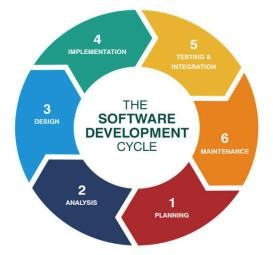

# 01 · Planning

> SDLC phase 1 of 6 · **Status: ✅ Complete**

## Purpose
Design and propose **LawAid**, an AI-powered legal consultation and law management platform that simplifies access to legal help in Bangladesh: verified lawyers for online or in-person consultation, a practice-management toolkit for lawyers, and a free bilingual (Bangla + English) AI assistant for the public.

## Problem
Legal help in Bangladesh still runs on word-of-mouth referrals and physical chamber visits, concentrated in cities. Existing digital directories solve only one slice (listings *or* chatbot *or* case tools). Survey research with clients and lawyers surfaced five recurring problems:

| # | Problem | Evidence |
|---|---|---|
| 1 | Hard to find trustworthy lawyers | Most respondents rely on personal referrals |
| 2 | Low legal literacy | No plain-language access to rights and penalties |
| 3 | Fragmented, opaque processes | Manual scheduling, communication and payment |
| 4 | Inefficient practice management for lawyers | Scheduling conflicts, document handling, payment tracking |
| 5 | Low trust in payments | Secure, verifiable payments seen as necessary |

## Goals
- Faster, cheaper, location-independent access to verified lawyers via AI matching and flexible formats (video, audio, chat, in-person)
- A digital practice-management channel for lawyers
- Free plain-language legal literacy for the public
- Trust through verified profiles (NID + Bar Council certificate), transparent ratings and QR-verified escrow payments

## SDLC model: Agile (iterative-incremental)

Why Agile fits: requirements evolved through real feedback (the SOS emergency lawyer finder and privacy trust seals came from survey responses), each phase built on the previous one, and short feedback loops de-risk trust, lawyer acquisition and AI liability early.

| Phase | Status | Where |
|---|---|---|
| 1. Planning | ✅ Done | this folder |
| 2. Requirement analysis | ✅ Done | [`../02-requirement-analysis`](../02-requirement-analysis) |
| 3. System design (UML + UI/UX) | ✅ Done | [`../03-system-design`](../03-system-design) |
| 4. Implementation | 🔜 Planned | React/Next.js + Flutter, Node.js/Express + FastAPI |
| 5. Testing | 🔜 Planned | functional, verification, security, usability |
| 6. Deployment & maintenance | 🔜 Planned | live gateways, lawyer onboarding, feedback loop |

## Planned technology stack
Figma · Canva · React.js / Next.js (web) · Flutter (mobile) · Node.js / Express · Python / FastAPI · PostgreSQL · OpenAI / Gemini API · Cloudinary · Google Maps API · SSLCommerz / bKash / Nagad

## Feasibility and SWOT
See [`feasibility-and-swot.md`](feasibility-and-swot.md).
