# Feasibility & Requirements Survey

| | |
|---|---|
| **Type** | Online questionnaire (Google Forms), bilingual Bangla/English |
| **Questions** | 23 |
| **Highest response count** | 59 |
| **Audience** | General clients/users and practicing lawyers |

## Key findings
- 64.4% of respondents were general clients and 35.6% were lawyers, which supports a **two-sided (client + lawyer) portal**
- 86.4% found AI-based lawyer matching useful
- 89.8% wanted the 24/7 SOS emergency lawyer finder
- 78% prefer a consultation session under 1,000 BDT
- 49.2% raised privacy concerns and 42.4% payment concerns, driving verification, escrow and encryption

## Result charts
Charts are named after the survey question number.

| | | |
|---|---|---|
| 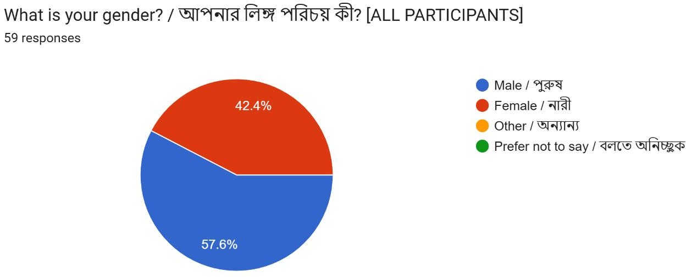 | 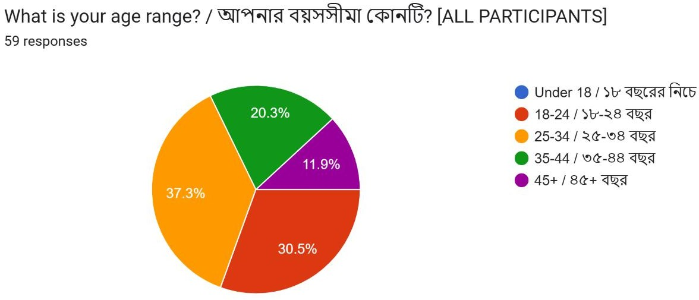 | 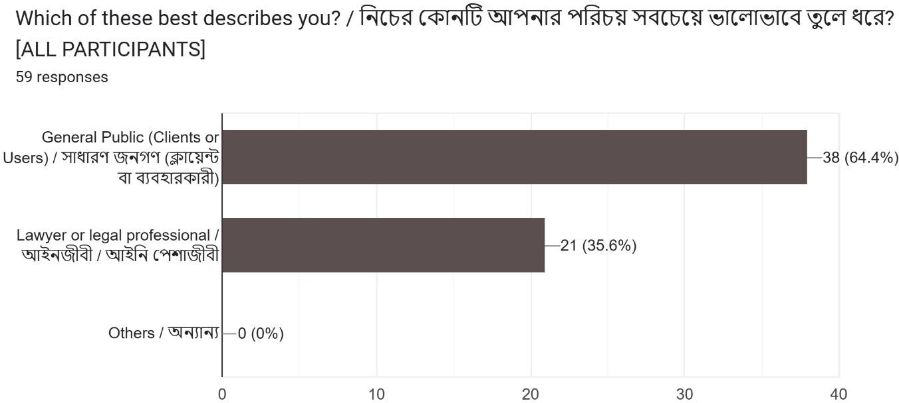 |
| 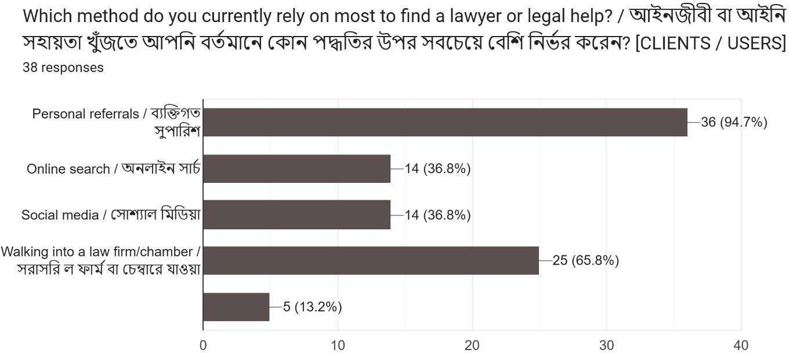 | 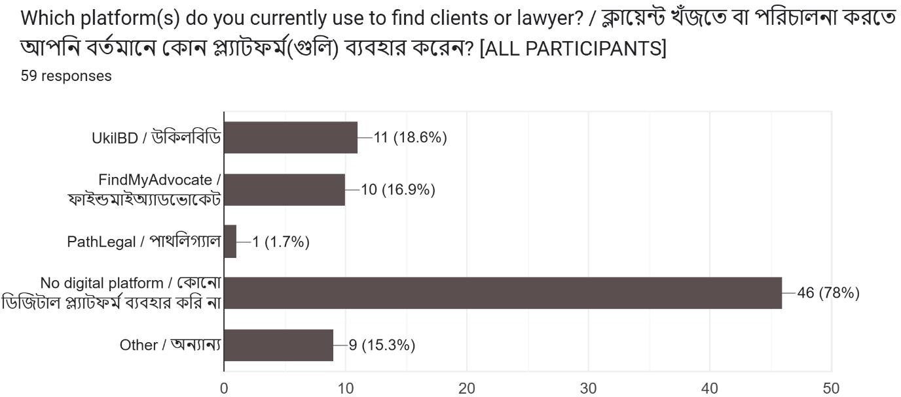 | 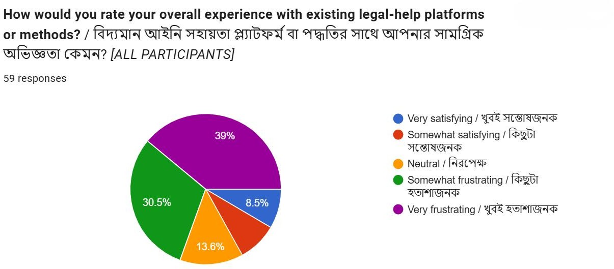 |
| 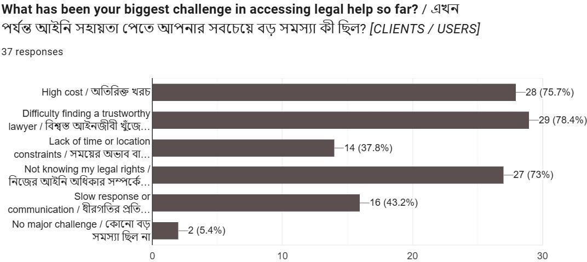 | 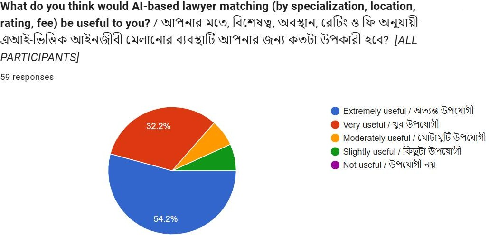 | 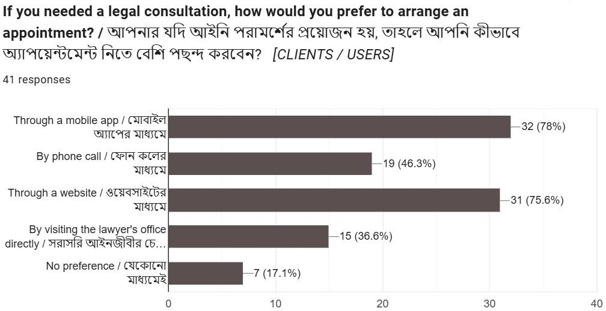 |
| 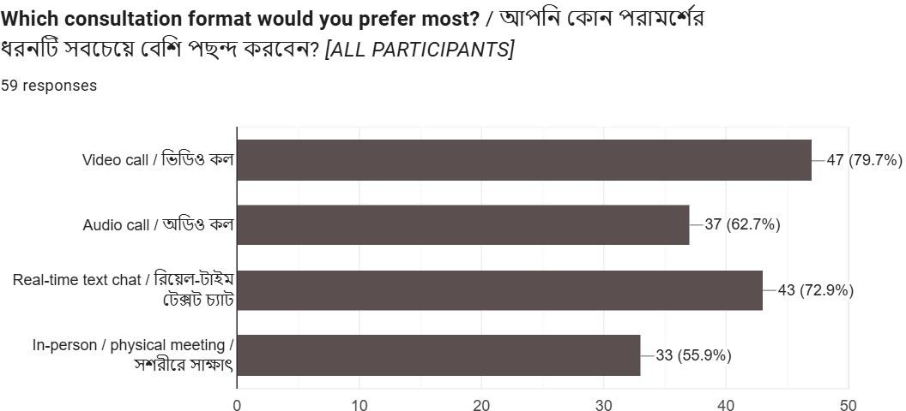 | 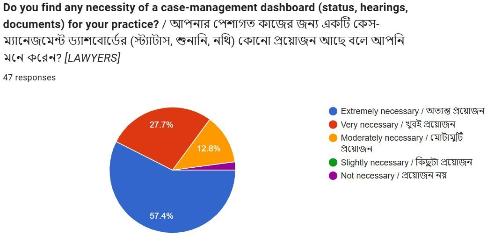 | 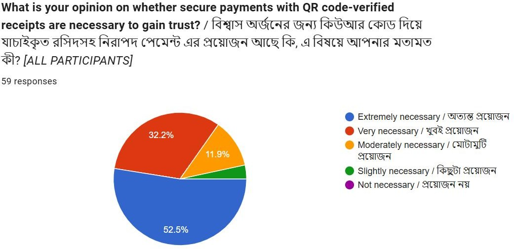 |
| 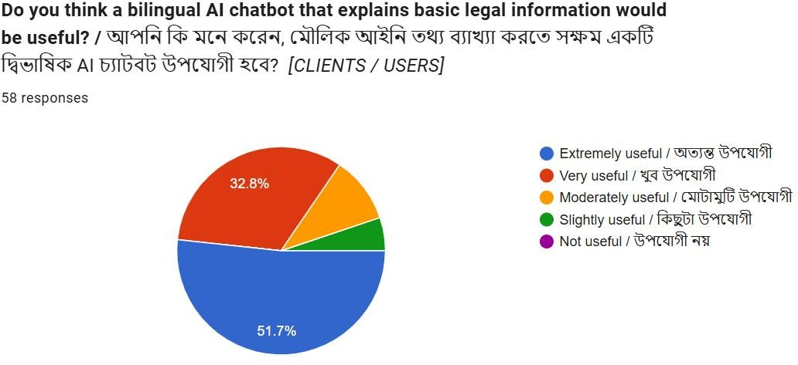 | 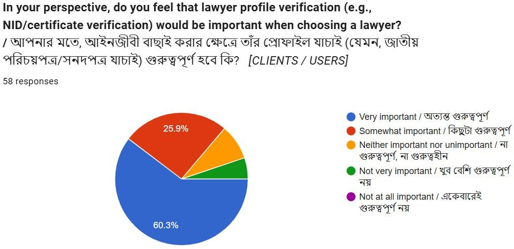 | 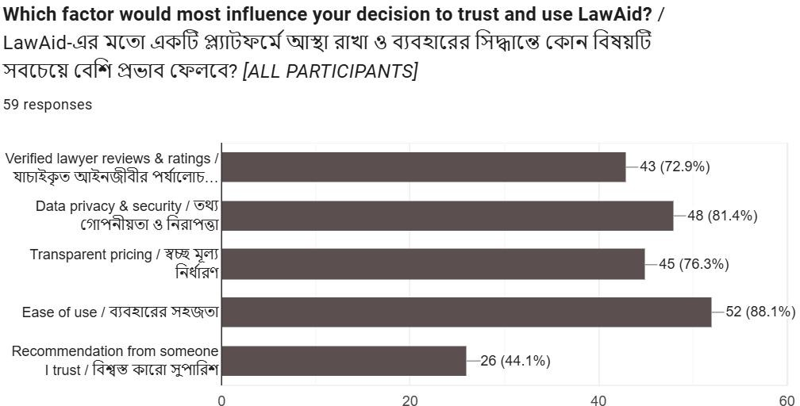 |
| 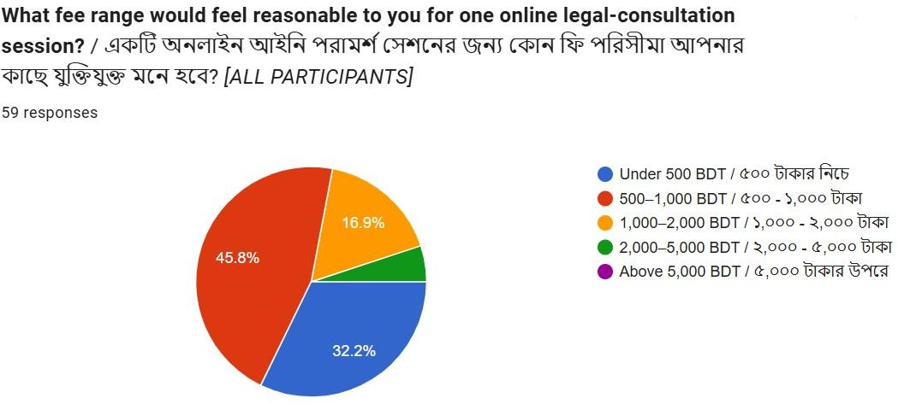 | 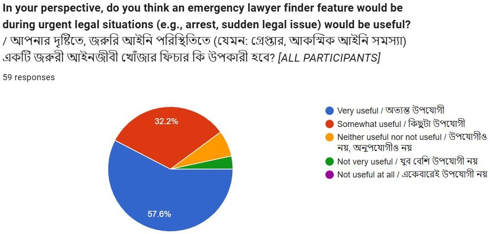 | 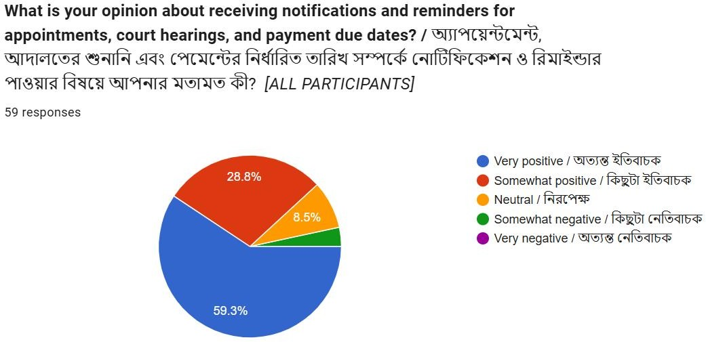 |
| 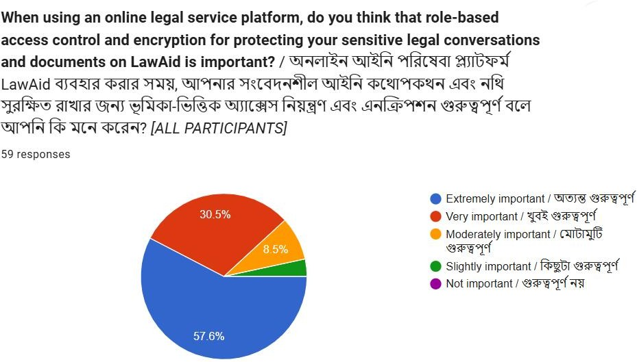 | 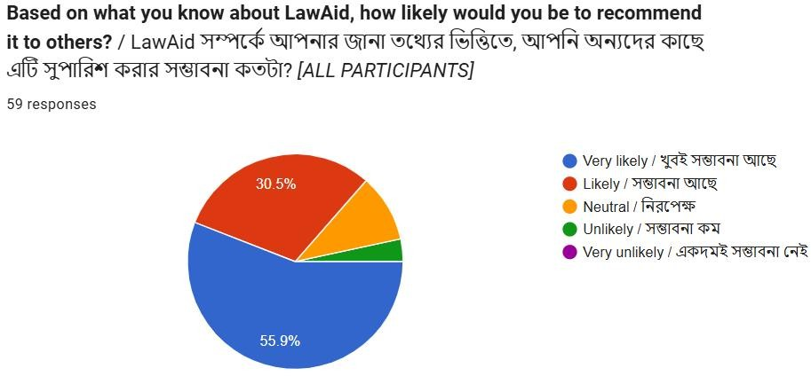 | |

## Survey questions
1. Gender · 2. Age range · 3. Which describes you best · 4. Method used most to find a lawyer · 5. Platforms used · 6. Overall experience with existing methods · 7. Biggest challenge managing practice / reaching clients digitally · 8. Biggest challenge accessing legal help · 9. Usefulness of AI-based matching · 10. Preferred way to arrange an appointment · 11. Preferred consultation format · 12. Need for a case-management dashboard · 13. Necessity of QR-verified payment receipts · 14. Usefulness of a bilingual AI chatbot · 15. Importance of lawyer profile verification · 16. Factor that most influences trust · 17. Reasonable fee range per online session · 18. Usefulness of an emergency lawyer finder · 19. Notifications and reminders · 20. Role-based access control and encryption · 21. Concerns that would make you hesitant · 22. Top 3 features you would use · 23. Likelihood to recommend LawAid
