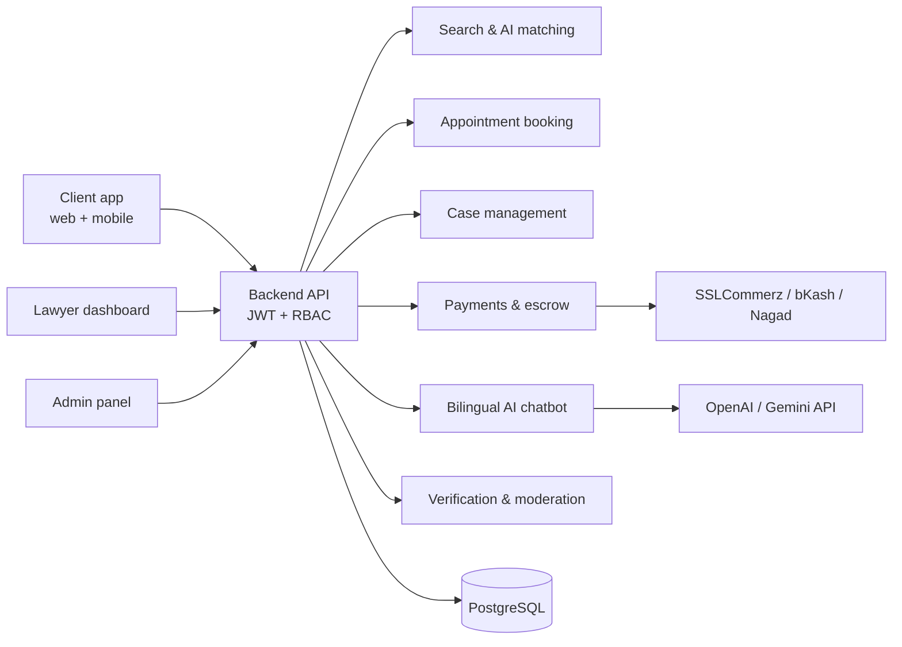

# 03 · System Design

> SDLC phase 3 of 6 · **Status: ✅ Complete**

| Folder / file | Contents |
|---|---|
| [`uml-diagrams/`](uml-diagrams) | Use case, activity, data flow, class, sequence, state diagrams and CRC cards |
| [`use-case-descriptions.md`](use-case-descriptions.md) | Fully specified descriptions of the 3 major use cases |
| [`ui-ux-prototype/`](ui-ux-prototype) | High-fidelity Figma prototype: 6 web and 7 mobile screens, design system, navigation flow |

## Architecture at a glance
Two-sided portal (Client app + Lawyer dashboard) plus an Admin panel, built from independent modules (NFR-21).

