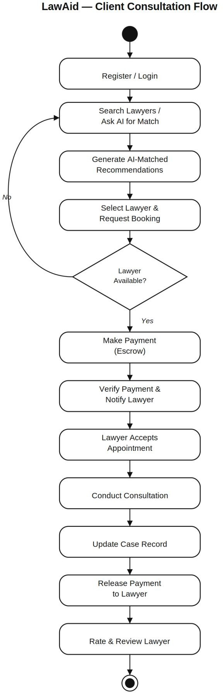
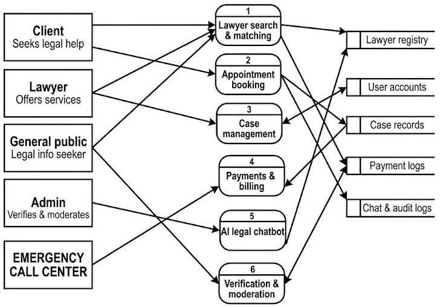
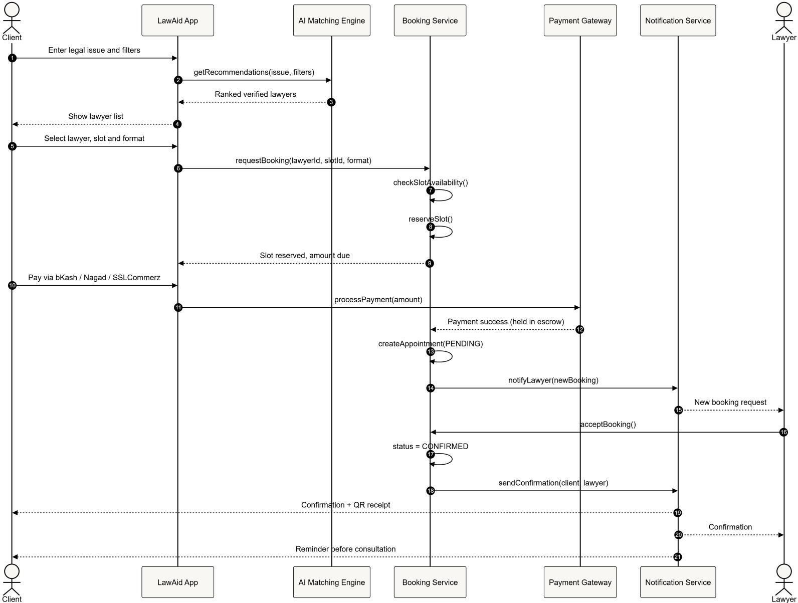
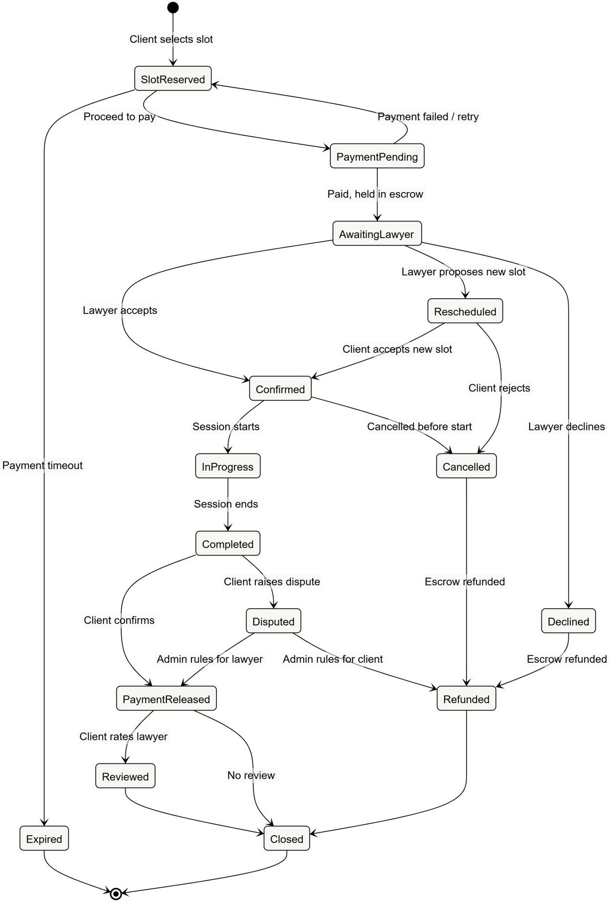
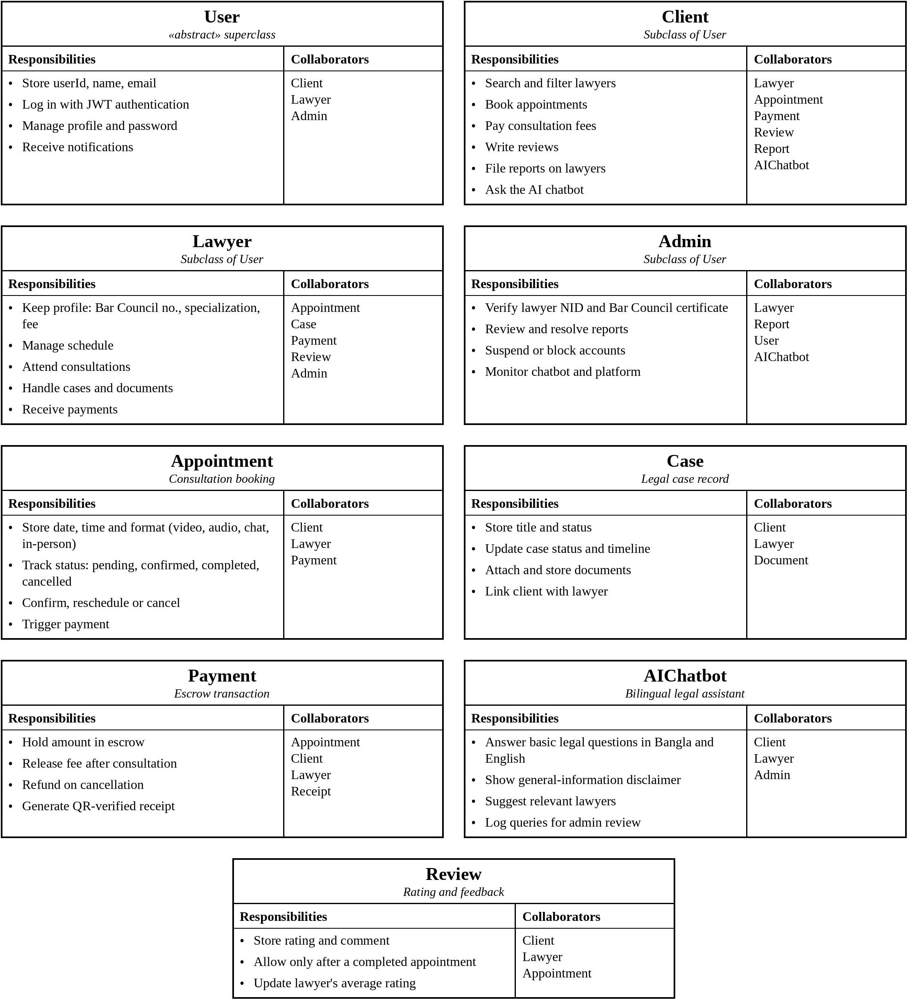

# UML & Analysis Diagrams

## 1 · Use case diagram
Actors: Client, Lawyer, Admin. Key use cases: register/login, search & filter lawyers, AI-matched recommendation, book appointment, make payment, track case status, rate & review, consultation (video/audio/chat), manage availability, manage case records, receive payment, verify lawyer credentials, moderate reports & accounts, ask AI legal chatbot.

## 2 · Activity diagram: client consultation flow

## 3 · Data flow diagram
Six processes: lawyer search & matching, appointment booking, case management, payments & billing, AI legal chatbot, verification & moderation. Data stores: lawyer registry, user accounts, case records, payment logs, chat & audit logs.

## 4 · Class diagram

## 5 · Sequence diagram

## 6 · State diagram

## 7 · CRC cards

