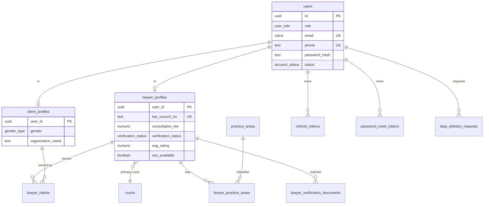
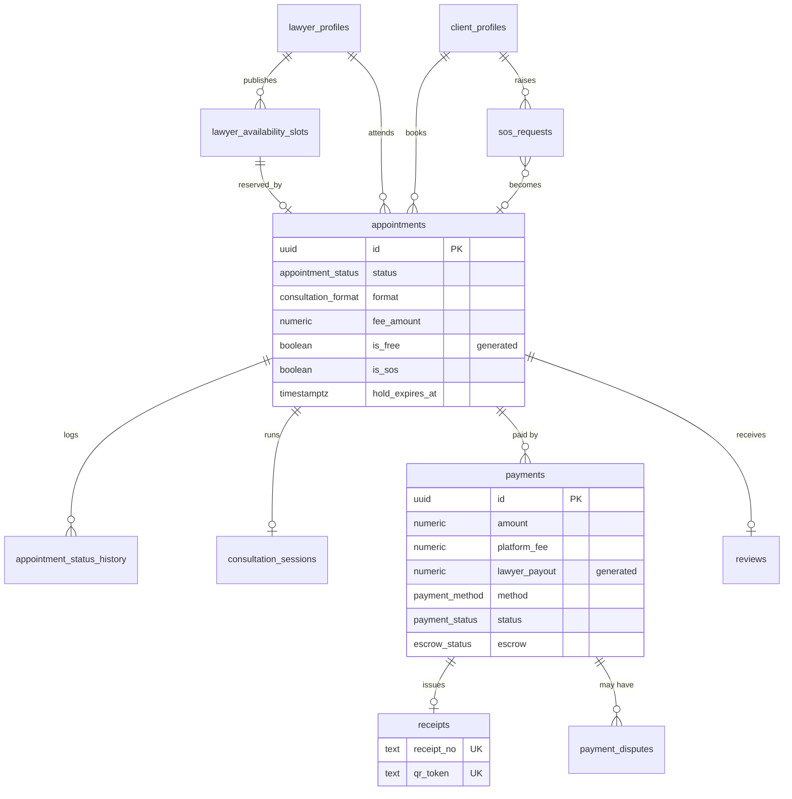
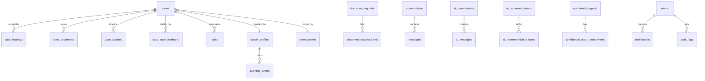

# LawAid – Database Design

**Project:** LawAid – AI-Powered Legal Assistant & Law Management System (Team SysVision)
**DBMS:** PostgreSQL 18 (schema `lawaid`)
**Files:** `schema.sql` (DDL, triggers, views) · `seed.sql` (demo data) · this document

> **Note on the version:** MySQL has no 18.x release, and the SRS (Ch. 1.4.2) specifies PostgreSQL, so everything targets **PostgreSQL 18**. It uses the native `uuidv7()` function introduced in PG 18. On PG 13–17, create a `uuidv7()` function or switch the defaults to `gen_random_uuid()`.

---

## 1. Quick start

```bash
createdb -U postgres lawaid
psql -U postgres -d lawaid -v ON_ERROR_STOP=1 -f schema.sql
psql -U postgres -d lawaid -v ON_ERROR_STOP=1 -f seed.sql
```

`schema.sql` drops and recreates the `lawaid` schema, so it is safe to re-run during development. Do **not** run it against production data.

**Demo logins (all passwords `LawAid@123`, bcrypt-hashed in the seed):**

| Role | Email | Matches prototype |
|---|---|---|
| Admin | `rahid.karim@lawaid.com.bd` | Admin dashboard (W3, M3) |
| Lawyer | `rezwana.karim@lawaid.com.bd` | Lawyer dashboard/cases (W5, W6, M5, M6) |
| Lawyer | `rafiqul.islam@lawaid.com.bd` | Client dashboard "today's session" (M4) |
| Client | `ahnaf.shahriar@example.com` | Client dashboard + AI assistant (W4, M4) |
| Client | `ayesha.rahman@example.com` | Chat with lawyer (M6) |
| Pending lawyer | `farhan.chowdhury@example.com` | Admin verification queue |

---

## 2. Design principles

| Principle | How it is applied |
|---|---|
| **Traceable to the SRS** | Every module maps to FR/NFR numbers (see section 6). |
| **Role integrity in the schema** | `client_profiles` and `lawyer_profiles` use a composite FK `(user_id, role) → users(id, role)` with a `CHECK` on `role`. A lawyer profile can never be attached to a client account. Appointments, cases and payments reference the *profile* tables, so a non-lawyer cannot be booked. |
| **State machine in the data** | `appointment_status` mirrors the State Diagram (7.7) exactly. Every change is logged automatically in `appointment_status_history`. |
| **Money is safe** | Escrow state is separate from payment state; a partial unique index allows only one successful charge per booking (NFR-17); no card/wallet numbers are stored, only gateway references (NFR-5). |
| **Concurrency-safe booking** | An exclusion constraint prevents overlapping slots per lawyer, and a partial unique index prevents two live appointments on the same slot. |
| **Privacy by design** | Verification files live in a private bucket, and confidential reports are protected by Row-Level Security, so reported lawyers can never read them (NFR-4, NFR-7). Soft delete and deletion requests support NFR-8. |
| **Audit everything critical** | `audit_logs` plus the status-history table cover FR-37. |
| **UUIDv7 keys** | Time-ordered, so they index well and don't leak row counts. Small reference tables use integer identity keys. |

---

## 3. Entity-relationship overview

The full model has 41 tables, so the diagrams are split by module.

### 3.1 Identity, lawyers and verification



### 3.2 Booking, payment and consultation



### 3.3 Case management, messaging, AI and trust



---

## 4. Table dictionary

### 4.1 Reference
| Table | Purpose |
|---|---|
| `courts` | Courts/tribunals (Supreme Court divisions, district, family, Artha Rin, labour, cyber). |
| `practice_areas` | Legal specialisations with English and Bangla names. |

### 4.2 Identity & verification
| Table | Purpose | Key constraints |
|---|---|---|
| `users` | One row per account for all roles. | `email` citext unique; phone must match `+8801[3-9]xxxxxxxx`; soft delete via `deleted_at`; `UNIQUE (id, role)`. |
| `client_profiles` | Client-specific fields (gender, org name, district). `created_by_lawyer_id` supports "Register New Litigant". | Role pinned to `client`. |
| `lawyer_profiles` | Bar Council no., fee, session length, formats, SOS flag, verification status, cached rating. | `bar_council_no` unique; fee ≥ 0; role pinned to `lawyer`. |
| `lawyer_practice_areas` | Many-to-many lawyer ↔ practice area. | Composite PK. |
| `lawyer_verification_documents` | NID and Bar certificate per lawyer, with review state. | Rejection requires a reason. |
| `refresh_tokens`, `password_reset_tokens` | JWT refresh rotation and password recovery (store hashes only). | Unique token hash. |
| `data_deletion_requests` | User right-to-erasure queue. | – |
| `lawyer_clients` | "My Clients" list. | Composite PK. |

### 4.3 Booking & consultation
| Table | Purpose | Key constraints |
|---|---|---|
| `lawyer_availability_slots` | Bookable time windows. | **Exclusion constraint** (no overlap per lawyer); `is_booked` kept in sync by trigger. |
| `appointments` | A booking: format, status, fee, SOS and AI flags, payment-hold expiry. | Partial unique index on `slot_id` for live statuses; `is_free` is a generated column. |
| `appointment_status_history` | Immutable transition log. | Written by trigger. |
| `consultation_sessions` | Live call/chat room with start/end; `duration_sec` is generated. | One per appointment. |
| `sos_requests` | 24/7 emergency lawyer finder (FR-16). | Partial index on open requests. |

### 4.4 Payments
| Table | Purpose | Key constraints |
|---|---|---|
| `payments` | One row per charge attempt: amount, platform fee, generated `lawyer_payout`, gateway, escrow state. | One successful payment per appointment; unique `(method, gateway_txn_id)`; escrow only valid after success. |
| `receipts` | QR-verified receipt. `receipt_no` comes from a sequence and `qr_token` is a random 128-bit token. | One per payment. |
| `payment_disputes` | Client dispute workflow (FR-25). | One open dispute per payment. |

### 4.5 Case management
| Table | Purpose |
|---|---|
| `cases` | Case record: number, title, court, bench, urgency, status, parties, `next_hearing_at` (maintained by trigger). |
| `case_hearings` | Hearing dates/outcomes. |
| `case_team_members` | Who works on the case and in what role. |
| `case_updates` | Timeline; `is_client_visible` hides internal notes. |
| `case_documents` | Files with review status (`pending_review` / `verified` / `action_required`). |
| `document_requests`, `document_request_items` | Lawyer requests documents from a client or registry. |
| `tasks`, `calendar_events` | Lawyer to-do list and schedule. |

### 4.6 Communication & AI
| Table | Purpose |
|---|---|
| `conversations`, `messages` | Client ↔ lawyer chat. `body` may hold ciphertext when E2EE is on. |
| `ai_conversations`, `ai_messages` | Public/anonymous or logged-in chatbot history. Tracks language, tokens, `is_out_of_scope` (FR-29), a `citations` JSONB (reserved for the RAG future work) and an admin review flag. |
| `ai_recommendations`, `ai_recommendation_items` | Explainable AI matching: ranked lawyers with score and reason (FR-7, future work 9.3.7). |

### 4.7 Trust, notifications, platform
| Table | Purpose |
|---|---|
| `reviews` | One review per completed appointment. |
| `confidential_reports`, `confidential_report_attachments` | Misconduct reports; admin-only via RLS. |
| `notifications` | Push/SMS/WhatsApp/email/in-app queue with schedule and read state. |
| `audit_logs` | Who did what, when, from where (JSONB metadata). |
| `content_items` | Admin-managed bilingual guides, FAQs and policies. |
| `system_settings` | Key/value configuration (platform fee %, slot hold minutes, AI model). |

---

## 5. Business rules enforced in the database

| Rule | Mechanism |
|---|---|
| Only **approved** lawyers can be booked (FR-3) | `BEFORE INSERT` trigger `chk_lawyer_approved` on `appointments` |
| No double-booked slot | Partial unique index `uq_appt_active_slot` |
| A lawyer cannot publish overlapping slots | `EXCLUDE USING gist` on `tstzrange` |
| Slot flag stays correct when bookings are cancelled or declined | Trigger `sync_slot_booking` |
| Every status change is recorded (FR-37) | Trigger `log_appointment_status` (reads `lawaid.user_id` from the session) |
| Reviews only after a completed consultation, by the same client (FR-30) | Trigger `chk_review_allowed` |
| Average rating and review count are always correct (FR-31) | Trigger `refresh_lawyer_rating` |
| `cases.next_hearing_at` always reflects the next scheduled hearing | Trigger `refresh_next_hearing` |
| One successful charge per booking | Partial unique index `uq_payment_one_success` |
| Escrow released only after completion (FR-22) | Function `release_escrow(appointment_id)` (atomic) |
| Unpaid holds expire | Function `expire_unpaid_holds()` (schedule every minute with `pg_cron` or the app scheduler) |
| Reported lawyer can never read a report (NFR-7) | RLS on `confidential_reports`, with no lawyer `SELECT` policy |
| `updated_at` maintained | Generic trigger attached to every table that has the column |

### Using RLS and the audit actor from the API
Run these at the start of each request transaction:
```sql
SET LOCAL lawaid.user_id = '<jwt sub>';
SET LOCAL lawaid.role    = 'client';   -- client | lawyer | admin
```
Connect the application with a **non-owner role** (the owner bypasses RLS):
```sql
CREATE ROLE lawaid_app LOGIN PASSWORD '...';
GRANT USAGE ON SCHEMA lawaid TO lawaid_app;
GRANT SELECT, INSERT, UPDATE, DELETE ON ALL TABLES IN SCHEMA lawaid TO lawaid_app;
GRANT USAGE ON ALL SEQUENCES IN SCHEMA lawaid TO lawaid_app;
```

---

## 6. Requirement traceability

| SRS requirement | Tables / objects |
|---|---|
| FR-1 – FR-5 Registration, JWT login, password reset | `users`, `client_profiles`, `lawyer_profiles`, `refresh_tokens`, `password_reset_tokens` |
| FR-2, FR-3, FR-38 Lawyer verification | `lawyer_verification_documents`, `lawyer_profiles.verification_status` |
| FR-6 – FR-9 Search, AI matching | `v_lawyer_search`, `lawyer_practice_areas`, `ai_recommendations`, `ai_recommendation_items`, `idx_lawyer_search` |
| FR-10 – FR-14 Booking & consultation | `lawyer_availability_slots`, `appointments`, `consultation_sessions`, `messages` |
| FR-15, FR-36 Notifications | `notifications` |
| FR-16 SOS | `sos_requests`, `appointments.is_sos`, `lawyer_profiles.sos_available` |
| FR-17 – FR-20 Case management | `cases`, `case_hearings`, `case_documents`, `case_updates` |
| FR-21 – FR-25 Payments, escrow, QR receipt, disputes | `payments`, `receipts`, `payment_disputes`, `release_escrow()` |
| FR-26 – FR-29 AI assistant | `ai_conversations`, `ai_messages` (language, `is_out_of_scope`, `disclaimer_shown`) |
| FR-30 – FR-33 Reviews & confidential reports | `reviews`, `confidential_reports` (+ RLS) |
| FR-34, NFR-2 RBAC | `users.role`, role-pinned profiles, RLS, `lawaid_app` grants |
| FR-35, NFR-1 Encryption | `case_documents.is_encrypted`, `messages.body` (ciphertext), private file URLs; TLS and disk encryption at infrastructure level |
| FR-37, NFR-22 Audit | `audit_logs`, `appointment_status_history` |
| FR-39, FR-40 Admin actions | `users.status` / `suspended_*`, `confidential_reports.status` |
| NFR-4 ID documents visible to admins only | Private storage URLs in `lawyer_verification_documents` |
| NFR-5 No raw card data | `payments` stores only gateway transaction reference and sanitized payload |
| NFR-8 Data deletion | `data_deletion_requests`, `users.deleted_at` |
| NFR-10 Bilingual | `preferred_language`, `name_bn` / `title_bn` / `body_bn` columns |
| NFR-13 Search < 3 s | Partial/composite/trigram indexes (section 7) |
| NFR-16 – NFR-18 Reliability & integrity | Unique/exclusion constraints, atomic `release_escrow`, soft delete |
| NFR-21 Modular architecture | Table groups map 1:1 to the services (search, booking, payments, chatbot, cases) |

---

## 7. Indexing strategy

| Query | Index |
|---|---|
| Lawyer search by area, rating and fee | `idx_lawyer_search` (partial, approved only); `lawyer_practice_areas(practice_area_id)` |
| Fuzzy name/case search | `gin_trgm_ops` on `users.full_name` and `cases.title` |
| "Next open slot" | `idx_slots_open` (partial, `NOT is_booked`) |
| Dashboards | `appointments(client_id, scheduled_start DESC)`, `appointments(lawyer_id, …)`, `cases(lawyer_id, status)` |
| Slot-hold expiry job | `idx_appt_hold` (partial on pending statuses) |
| Admin verification queue | `idx_lvd_queue` (partial on `pending`) |
| Notification dispatcher | `idx_notif_queue` (partial on `queued`) |
| Escrow monitoring | `idx_payments_escrow` (partial on `held`/`disputed`) |
| SOS matching | `idx_lawyer_sos`, `idx_sos_open` |

Partial indexes keep the hot paths small as history grows.

---

## 8. Views

| View | Used by |
|---|---|
| `v_lawyer_search` | Find Lawyers page: verified lawyers with specialisations and next free slot |
| `v_admin_overview` | Admin dashboard cards (clients, verified lawyers, revenue, escrow held, open reports) |
| `v_lawyer_dashboard` | Lawyer dashboard counters (today's sessions, pending requests, active cases, tasks) |
| `v_client_payment_history` | Client payments page with receipt number and QR token |

---

## 9. Seed data summary

| Entity | Rows | Notes |
|---|---|---|
| Users | 19 | 2 admins, 7 lawyers (5 approved, 1 pending, 1 rejected), 10 clients |
| Appointments | 15 | Covers confirmed, completed, reviewed, awaiting, declined/refunded, payment pending, disputed, free, and SOS |
| Payments / receipts | 14 / 13 | bKash, Nagad and SSLCommerz; escrow in `held`, `released`, `refunded`, `disputed` |
| Cases | 6 | Metro Housing, Apex Pharma, Biman Logistics, Hassan Estate, and others from the prototype |
| Slots | about 75 | 7 days × 2 times × 5 lawyers, plus 5 explicit booked/held |
| Others | – | Hearings, documents, tasks, chat, AI conversations (Bangla and English), reports, notifications, CMS items, settings |

All dates are relative to `now()`, so the demo stays current. Ratings are computed by the trigger from the seeded reviews, so they will differ from the prototype's static "4.9 (124 reviews)".

---

## 10. Production notes

1. **Encryption:** the schema only provides the *columns*. Use TLS, encrypted volumes and an encrypted object store for files. For true end-to-end chat encryption, the client encrypts before insert and `messages.body` holds ciphertext.
2. **Partitioning:** if volume grows, partition `audit_logs`, `messages` and `ai_messages` by month.
3. **Backups:** enable WAL archiving and point-in-time recovery (NFR-18). Retain case documents for the life of the case.
4. **Data residency:** the Personal Data Protection Ordinance 2025 (SRS ref. [10]) may require sensitive client files to stay in Bangladesh. Pick a region or object store accordingly.
5. **Future RAG (SRS 9.3.1):** install `pgvector` and add `legal_corpus(act, section, text, embedding vector)`. `ai_messages.citations` is already in place to hold the cited Act and section.
6. **Free-legal-aid referral (9.3.3):** add a `legal_aid_offices` table and an eligibility flag on `client_profiles`.
7. **Platform fee:** the seed sets 10% via `system_settings.platform_fee_percent`. Your business model may differ, so change it in one place.
